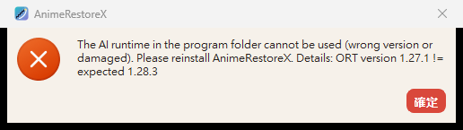

# AnimeRestoreX v2.0 — P3 報告（最小整合）

- 日期：2026-11-03；分支 `v2.0-prep`
- 環境：Windows 11 Home 10.0.26200、GTX 1060 6GB、Windows ML 2.5.96（ORT 1.28.3、DirectML 1.15.4）、Qt 6.12.0 msvc2022_64、MSVC 14.51、CMake 3.26 以上
- 模型：nunif swin_unet/art 20250502（改寫後的 Pad→Slice 版本，雜湊見 `models/manifest.json`）

## 1. 判定

**P3 通過。** 規劃 §P3 的通過條件「讀圖 → 推論 → 編碼 → 不覆寫提交，UI 可回應、取消可回收資源」都有執行證據（§4）。整合後的輸出與 P2 `tile_runner` **逐位元相同**（18 組，含 RGBA）。

附帶的發現：

- **編碼中取消要等編碼完成**（4× WebP 無損最多約 6 s，§4.3）。
- **P3 新增的字串還沒翻譯**（§4.5 截圖是英文）。
- **v2.0 與 v1.2 共用同一份設定**，遷移會刪掉 v1.2 的 tile 與估速資料（§6）。

這三項都不影響 P3 的判定，已列入 P4／P5 待辦（§7）。

## 2. patch 順序（每個 commit 都能編譯，ctest 全部通過）

| # | commit | 內容 |
|---|---|---|
| 1 | `8c4bdd7` | P2 模組搬到 `src/core/inference/`（`arxinfer`，不依賴 Qt）；`tst_inference_core` 共 445 項 |
| 2 | `82597c9` | `tools/fetch-runtime.ps1`、`tools/fetch-models.ps1`（雜湊固定）；CMake 3.26；`arxort`（delay-load `onnxruntime.dll`）；DLL 與模型複製到 exe 旁邊 |
| 3 | `7dedd70` | AppSettings schema 2（tile 為 Auto／160／256／400，處理裝置 GPU／CPU） |
| 4 | `baac755` | 換引擎：`Backend`／`EngineHost`／`TilePolicy`，ProcessJob／BatchRunner 改接 Backend，移除 waifu2x-ncnn-vulkan（Runner、ChildProcessGuard、fetch 腳本、部署步驟） |
| 5 | 本報告的 commit | `checkOptions` 只接受 Auto／160／256／400（縱深防禦）；`arx_verify` 驗證工具；UI 實機取消測試；本報告與截圖 |

## 3. 自動測試（ctest 5/5）

| 測試 | 結果 | 內容 |
|---|---|---|
| `tst_core` | 通過 | 新增 `modelIdAndOptions`（模型 ID、1× 需要降噪、tile 清單；**手改設定檔的值**：100／200／250／300、64／112／640／1024、16／1／−1／−256／INT_MAX 全部被 `checkOptions` 與 `checkPreconditions` 拒絕，與 `AppSettings::isValidTile` 用同一份清單）、`tilePolicy`、`progressPlanFollowsStages`；runtime 錯誤訊息包含版本 |
| `tst_inference_core` | 445 項通過 | P2 模組（假引擎） |
| `tst_pipeline` | 23 項通過、0 SKIP | 假 Backend（真實 manifest＋最近鄰引擎）：OOM 時 Auto 改用 160 重做、手動 tile 遇 OOM 只讓該張失敗並重建 Session、DeviceLost（887A0005）停止批次而且不重試、雜湊不符在第一張之前停止、runtime 缺少或版本不符、取消（單張與批次）、VRAM 不足時用 160 並依序開 Session、CPU 裝置、重名不覆寫、輸入與輸出同資料夾、**處理中輸出資料夾被刪除（可控制的寫入失敗）**、壞圖、**手改 tile 640／112／200 時批次不啟動、引擎不會被呼叫**。另外 `realRuntime2x` 用真實 DML 跑完 |
| `tst_ui` | 27 項通過、9 SKIP | SKIP 都是 layout 項目，這些在 `tst_ui_layout` 用 windows 平台執行。`fullBatchThroughMainWindow`（真實 DML）與新增的 `cancelThroughMainWindow`（真實 DML）都有實際執行 |
| `tst_ui_layout` | 通過 | |

## 4. 實機驗證（`tests/arx_verify.cpp`，結果在 `tools/winml-probe/_work/p3/`，不進 git）

`arx_verify` 是開發用工具，不加入 ctest。它在同一個程序內用真實的 `EngineHost` 跑 `runBatch`，每一項都記錄結果、實際使用的 tile、耗時、處理後的 private bytes，以及取消延遲（JSON lines）。輸入是 `_work/test-images` 的 6 張實圖，外加一張壞圖。

### 4.1 單張（`single.jsonl`）

輸入三種格式：`a_alpha.png`（RGBA）、`b_photo.jpg`（RGB）、`c_alpha.webp`（RGBA，無損）。每張都用 2× PNG（noise1）、4× WebP 有損（noise3）、2× JPEG（noise0）輸出。

| 檢查 | 結果 |
|---|---|
| 9 項全部成功，tile 256 | 通過 |
| 尺寸正好是 W×scale、H×scale | 通過（例如 666×432 → 1332×864／2664×1728） |
| 透明輸入的 PNG／WebP 輸出保留 alpha | 通過（輸入 alpha 本來就沒有 0；輸出範圍 1–253） |
| JPEG：透明處合成白底 | 通過（角落 (246,241,247)，輸入角落 alpha 153） |
| WebP 有損 = VP8；WebP 無損 = VP8L | 通過 |
| 輸出資料夾沒有 `.tmp` 殘留 | 通過 |

### 4.2 批次與記憶體（`batch.jsonl`）

7 個檔案 × 7 組設定（1× n3 PNG、2× n−1 PNG、4× n3 PNG、2× n1 WebP、4× n0 JPEG、1× n2 WebP 無損、再一次 2× n−1 PNG），共 49 項，在**同一個程序**內連續執行，總共 144 s。

| 檢查 | 結果 |
|---|---|
| 42 張成功；壞圖 7 次都只讓該張失敗（「Cannot decode image」），批次繼續，沒有 fatal | 通過 |
| 每組結束後（Session 全部釋放）的 private：283.9／293.3／274.2／295.3／282.1／290.7／292.2 MiB，結束時 294.4 MiB | **不會累積**。殘留與 P2 量到的 278 MiB 相同，是 DML 第一次建立 device 後的固定成本（P2 未解問題 #2 結案） |
| Session 開著時的 private：1× 約 705 MiB、2× 約 712–731 MiB、4× 約 1.17 GB；4× 有 alpha 時 RGB 與 alpha 兩個 Session 並存，約 2.13 GB | 記錄（見 §7） |
| 每組第一張比較慢（6–9 s，含建立 Session），之後 2× 約 2–3 s、4× 約 4 s | 記錄 |
| 重名：第 7 組全部產生 `… (1).png`，內容與第 2 組相同；原檔的修改時間仍是第 2 組那次 | 通過（不覆寫） |

### 4.3 取消（`cancel/*.jsonl`）

每種情境都是「大圖＋一張小圖」，在第一張的指定階段取消。

| 情境 | 取消到該張結束 | 取消到批次結束 | 結果 |
|---|---|---|---|
| DML 推論中（2600×1730 2×，推論開始後 6 s） | **57 ms** | 149 ms | canceled，2 張都未處理，沒有檔案；釋放後 283.8 MiB |
| 編碼開始的那一刻（4× WebP 無損） | 6,081 ms | 6,169 ms | canceled，沒有檔案、沒有 `.tmp` |
| 編碼開始後 300 ms | 5,737 ms | 5,823 ms | 同上 |
| CPU 推論中（1×，SetTerminate） | **2 ms** | 33 ms | canceled，沒有檔案；釋放後 **19.5 MiB**（CPU 沒有 DML 那種殘留） |
| UI（`cancelThroughMainWindow`，3 MP 4×，推論中按取消） | — | 按下取消到出現摘要 **274 ms** | GUI event loop 最大停頓 **43 ms**；「未處理：2」；輸出資料夾是空的 |

**發現：**編碼器（Qt 的 WebP、PNG 外掛）在編碼時不能中斷。ProcessJob 會在編碼完成、提交之前檢查取消，所以結果正確（不產生檔案），但要等編碼結束：4× WebP 無損（3456×2312）大約 6 s。UI 在這段時間仍然可以操作，狀態列顯示「正在取消」。列為 P4 待辦。

### 4.4 一致性：與 P2 `tile_runner` 逐位元比較（`bitwise.json`）

app 的 PNG 輸出（經過 ImageLoader → ProcessJob → ImageEncoder）與 P2 用 `tile_runner` 產生的 ARX8（`_work/p2/ours`，tile 256，同一份模型）比較：

| 模型 | 圖片 | 結果 |
|---|---|---|
| noise3（1×） | 6 張（含 RGBA） | 6／6 **完全相同**（max diff 0） |
| scale2x（2×） | 6 張（含 RGBA，alpha 走 helper） | 6／6 完全相同 |
| noise3_scale4x（4×） | 6 張（含 RGBA，alpha 走 scale4x helper） | 6／6 完全相同 |

P2 已證明 `tile_runner` 與上游 nunif 的差 ≤ 1 LSB，所以整合後的 app 也一樣。

### 4.5 錯誤與來源（staging：`_work/p3-stage`，測完已刪除）

把 build 輸出的 `AnimeRestoreX.exe`、`arx_verify.exe`、兩個 DLL 和 `models/` 複製到 `_work/p3-stage`（**不含** `waifu2x/`），所有修改只在這個複本上做，`build/` 裡的檔案沒有動過（之後確認 `build/release/onnxruntime.dll` 仍是 1.28.3）。

| 檢查 | 結果 |
|---|---|
| A. staging 不含 `waifu2x/`，正常處理 | 成功；DLL 解析到的是 staging 自己的 `onnxruntime.dll`／`DirectML.dll`（路徑固定在程式資料夾） |
| B. staging 裡的 `noise1_scale2x.onnx` 改掉 1 個 byte（雜湊 AFA6… → 0BE2…） | 第一張之前就停止：「A model file is damaged or was replaced (its checksum does not match models/manifest.json)…」；未處理 1，沒有檔案；沒有改用其他模型 |
| C. staging 的 DLL 換成 2.4.89（ORT 1.27.1） | runtime 拒絕：「ORT version 1.27.1 != expected 1.28.3」，不會呼叫 `GetApi`，也沒有崩潰；批次不啟動。app 啟動時顯示錯誤訊息，主視窗仍會開啟（截圖 `docs/v2.0-P3/ort_2.4.89_startup.png`） |
| 壞圖 | §4.2（7 次都只讓該張失敗） |

截圖中的訊息是英文，因為 P3 新增的字串還沒更新進 `.ts`（翻譯檔有載入；按鈕「確定」是 Qt 自己的翻譯）。另外截了一張主視窗，因為裡面有使用者的真實路徑，沒有保留。

### 4.6 安全

| 檢查 | 證據 |
|---|---|
| 重名不覆寫 | 實機 §4.2（7 組 `(1)`、原檔不變）；`tst_pipeline::sameNameGetsNumbered` |
| 輸入與輸出同資料夾 | `tst_pipeline::sameFolderAsSource`（來源雜湊不變、沒有 `.tmp`） |
| 可控制的寫入失敗 | `tst_pipeline::outputFolderGoneFailsCleanly`（工作開始後刪除輸出資料夾 → 在 encode 步驟失敗，不寫到其他地方，來源不變） |
| 來源檔不被修改 | `png2xOpaque`、`sameFolderAsSource`、`outputFolderGoneFailsCleanly` 都比對雜湊 |
| 模型、DLL 的來源 | §4.5 A–C |

## 5. `build/release/waifu2x/` 的處理

依指示保留（P5 封裝時用乾淨的 staging 和 allowlist 處理）。確認目前的程式與測試不會讀到它：

- 靜態檢查：`src/`、`tests/`、CMake、`build.ps1` 中沒有任何 `waifu2x/` 路徑或 exe／模型目錄的用法。只剩設定遷移的舊 key 字串（`model/tileSize`、`progress/rates/…/waifu2x/…`）和註解。
- CMake 不再產生、也不再複製這個資料夾。
- 執行期：§4.5 A 的 staging 不含這個資料夾，處理照樣成功。

## 6. 執行中發生的問題（已記錄）

- **啟動 app 截圖時，用的是使用者實際的設定**（`HKCU\Software\Kaido-MSVC\AnimeRestoreX`，v1.2 也用這份）。啟動時執行了 schema 1 → 2 遷移，刪掉 `model/tileSize` 與 `progress/` 估速資料，並寫入 `schema = 2`（`settings`、`model` 兩個 key 的最後寫入時間是 2026-11-03 22:48:42，就是那次啟動）。語言、路徑與視窗位置都保留了。舊值沒有備份，無法還原。影響：v1.2 的 tile 會回到預設值，估速要重新學習。之後手動啟動 app 前都會先 `reg export` 備份、測完再還原。
- 這也顯示一個產品問題：**v2.0 與 v1.2 共用同一個設定位置，遷移是破壞性的**。使用者兩版並存時，v1.2 會失去設定（§7）。

## 7. P4／P5 待辦

| # | 項目 | 階段 |
|---|---|---|
| 1 | P3 新增的字串（runtime、模型、OOM、裝置錯誤、tile 160 摘要等）加入 zh_TW／ja 翻譯 | P4 |
| 2 | 編碼中取消要等編碼完成（4× WebP 無損約 6 s）。可以考慮：大圖編碼前再檢查一次取消（已經有）、UI 顯示「正在完成編碼」，或改用可中斷的編碼路徑 | P4 |
| 3 | 設定共用：v2.0 改用獨立的設定位置（例如 `AnimeRestoreX2`，第一次啟動時複製 v1.2 的值），或遷移時不刪 v1.2 的 key | P4（要你決定） |
| 4 | 4× 有 alpha 時 private 約 2.1 GB（RGB＋alpha 兩個 Session）；RAM 較少的電腦可以考慮依 RAM 改成依序開 Session（目前只依 VRAM 判斷） | P4 |
| 5 | ETA：CPU 的預設速率是粗估；rate key 不含實際使用的 tile | P4 |
| 6 | 多 GPU 選擇（目前固定 DXGI 預設轉接器） | P4 |
| 7 | 真正的 OOM（8007000E）還沒在實機觸發過；VRAM 需求表只有 GTX 1060 的值 | P4（有其他卡時） |
| 8 | ORT 預設 logger 會把 `VerifyEachNodeIsAssignedToAnEp` 警告寫到 stderr；發布版是 GUI，不受影響，但可以調整 log level | P4 |
| 9 | `THIRD_PARTY_NOTICES.md.in`、`licenses/`、`tools/package.ps1`、`packaging/README.txt` 還寫著 waifu2x-ncnn-vulkan；`build/release/waifu2x/` 由乾淨的 staging 與 allowlist 排除 | P5 |
| 10 | 模型授權、Windows ML 授權 §3(b)(ii)、是否換成 swin_unet_v3_art | 待你決定（P0 延續） |

## 8. 這次查過的文件

- 沒有新查 Context7。用到的 API 都在 P1／P2／P3 前段確認過：CMake `copy_directory_if_different`、`add_custom_command POST_BUILD`；ORT `RunOptions::SetTerminate`、DML `device_id`；Qt `QImage` 外部緩衝區建構子（見 `docs/v2.0-P2報告.md` §14 與 P3 進度紀錄）。
- 本機標頭：Windows SDK `psapi.h`（`GetProcessMemoryInfo`、`PROCESS_MEMORY_COUNTERS_EX::PrivateUsage`）、`winreg.h`（只讀 key 的最後寫入時間，用來判斷 §6 的遷移時間）。這些是穩定的 Win32 API，沒有另外查。
