# AnimeRestoreX v2.0 — P4 報告（批次與回歸：使用者可見的部分）

- 日期：2026-11-03；分支 `v2.0-prep`
- 環境：同 P3（Windows 11 25H2 build 26200、GTX 1060 6GB、Windows ML 2.5.96／ORT 1.28.3／DirectML 1.15.4、Qt 6.12.0、MSVC 14.51）

## 1. 判定

**P4 通過。** 範圍 1–6 都已完成，也有測試或截圖作為證據；ctest 5/5 通過。設定遷移改成不破壞 v1.2：v1.2 的每一個鍵都維持原值，有單元測試保證。

有兩項 UI 顯示沒有在畫面上實際觸發（§4.4「未執行」），但它們的邏輯都有自動測試涵蓋。

## 2. 決策的實作

### 2.1 設定：共用但不破壞

| 類別 | 鍵 | v2.0 的行為 |
|---|---|---|
| 共用（兩版意義相同） | `ui/language`、`paths/sourceDir`、`paths/outputDir`、`window/geometry`、`window/splitter` | 讀寫（主題沒有設定鍵，兩版都跟隨 Windows） |
| v2.0 專屬 | `v2/schema`、`v2/model/noiseLevel`、`v2/inference/tileSize`、`v2/inference/device`、`v2/progress/lastDevice`、`v2/progress/rates/<裝置>/…` | 讀寫 |
| v1.2 專屬 | `model/noiseLevel`、`model/tileSize`、`progress/lastDevice`、`progress/rates/…` | **只讀**。第一次啟動時把 `model/noiseLevel` 複製到 `v2/model/noiseLevel`；tile 從 Auto 開始；v1.2 的估速不使用。不會刪除或覆寫 |
| P3 開發版留下的鍵 | `settings/schema`、`inference/*` | 不讀也不動 |

`AppSettings::migrate()` 已改寫，P3 時的刪除動作全部移除。

**手動啟動的隔離設定**：`AnimeRestoreX.exe --settings-dir <資料夾>` 會把所有設定寫進 `<資料夾>\Kaido-MSVC\AnimeRestoreX.ini`，不會碰登錄檔。這必須在第一個 QSettings 建立之前設定（Qt 文件：`setPath` 不影響已經存在的物件，而且只對 IniFormat 有效）。

實測：用這個參數啟動 app，前後比對 `HKCU\Software\Kaido-MSVC\AnimeRestoreX` 每個子 key 的最後寫入時間，全部沒有改變（`v2` 群組在登錄檔中不存在）；INI 裡只寫了 `[v2] schema=1`。本次所有截圖都用測試專用的設定（tst_ui 的 `QSettings::setPath`）或 `--settings-dir`，**沒有讀寫實際的設定**。

### 2.2 刪除 `docs/v2.0-P3進度.md`

已刪除（這個檔案沒有被 git 追蹤）。

## 3. 範圍的實作

| # | 項目 | 內容 |
|---|---|---|
| 1 | 翻譯 | lupdate 後各有 48 筆新字串（另移除 19 筆舊引擎的過時字串），zh_TW 與 ja 全部補齊：P3 的 runtime、模型、雜湊、OOM、裝置錯誤訊息，取消提示，裝置與後端資訊，設定說明。檢查結果：199 筆全部已翻譯、`%1`／`%2` 佔位符與原文一致、沒有控制字元；lupdate 重跑後 0 筆新增。依要求把「estimating time left」改譯為 zh「估算中」、ja「推定中」 |
| 2 | 進度與 ETA | rate key 改成 `nunif/<模型ID>@<模型 SHA-256 前 8 碼>/<dml\|cpu>/t<實際 tile>/x<倍率>`，存在 `v2/progress/rates/<裝置>` 底下，所以是依模型雜湊、EP、裝置、tile、倍率分組。計畫改在 prepare **之後**才產生（新增 `BatchCallbacks::prepared`），所以 Auto 用的是實際決定的 tile。**冷啟動與暖機分開**：每批第一張推論的固定開銷用 `<key>#cold` 學習（單位為秒）；暖機項目學每 MP 的速度；還沒有暖機速度時，先扣掉預設的冷啟動開銷（DML 4 s、CPU 1 s）。沒有資料時顯示「估算中」。CPU 預設倍率依實測從 20 倍改為 5 倍。狀態文字：VRAM 不足而改用 160（狀態列與單張進度）、OOM 後重做（單張進度「以 Tile 大小 160 重新 AI 處理」）、編碼中取消（「正在取消：正在完成目前檔案的編碼…」） |
| 3 | 設定對話框 | 選項只有 Auto／160／256／400 與 GPU（DirectML）／CPU。選 CPU 時說明會改成「CPU 比 GPU 慢很多：在測試電腦上約慢 5 倍…」。實測：2× 0.38–0.5 MP 的圖，CPU 13.9–15.8 s，GTX 1060 暖機後 2.9 s |
| 4 | AboutDialog | Windows ML 版本（CMake 的 `WINML_VERSION`）、ORT 版本、**DirectML 版本取自程式資料夾 DLL 的檔案版本**、模型來源（manifest：`waifu2x_onnx_models_20250502.zip`、nunif 匯出 commit `31c0137`、`https://github.com/nagadomi/nunif`）、實際載入的 runtime 路徑，以及本次執行實際使用的裝置（還沒處理過時顯示「本次執行尚未使用」） |
| 5 | 完成摘要 | 除了各類數量，另外依「失敗／未處理／成功」分段列出每個項目（成功的項目列出輸出檔名）。用了較小 tile 的項目標示 `[Tile 160]`，並附上說明「Tile 大小會讓結果略有不同」 |
| 6 | README | v2.0 說明、系統需求表、未測平台、已知限制（§5） |

另外修正兩處版面問題：

- **設定對話框**：日文的 tile 說明最後一行被截掉，處理裝置下方也多出空白。原因是 QLabel 自動換行時的高度計算。修正方式：說明欄固定最小寬度，換文字後依實際寬度重新計算高度。
- **預覽模式下拉選單**：日文在 1100 px 寬時仍被省略成「ウィンドウに合わせ...」，v1.2 也有這個問題。原因是 style sheet 的 padding 沒有算進 sizeHint。修正後偏好寬度依最長選項計算，最小寬度不變（不撐大視窗）。`tst_ui_layout` 的最小尺寸預算仍然通過。

## 4. 驗證

### 4.1 自動測試（ctest 5/5 通過）

| 測試 | 新增／修改 |
|---|---|
| `tst_core` | `settingsMigrateFromSchema1` 改寫：v1.2 的設定（12 個鍵，含 tile 200、兩組估速、P3 開發版的鍵）→ 啟動 v2.0 → 改 v2 的降噪、tile、裝置、估速 → 再啟動一次。**12 個鍵全部維持原值**，新增的鍵全部在 `v2/` 底下；v2 的初始值：降噪 = v1.2 的 2、tile Auto、GPU、沒有估速。空設定時也只寫 `v2/`。`progressPlanFollowsStages`：rate key 含雜湊、tile、倍率，冷啟動項目才有 `#cold`。新增 `estimatorColdAndWarm`：還沒有資料時是「估算中」；冷啟動項目在沒有暖機速度時扣掉預設開銷；有暖機速度後只學冷啟動開銷，暖機速度不受影響；下一批使用學到的冷啟動開銷 |
| `tst_ui` | 完成摘要：分段清單與 `[tile 160]` 標示；About：DirectML 1.15.4、模型 zip、nunif 網址、裝置；設定：只有 2 個裝置選項，選 CPU 時出現「much slower」；`fullBatchThroughMainWindow`（真實 DML）：實際存下的 key 是 `nunif/swin_unet/art/noise1_scale2x@afa6a24c/dml/t256/x2`，v1.2 的 `progress/lastDevice` 沒有被寫入；截圖改成 3 語言 × 淺深色 |
| `tst_pipeline`、`tst_inference_core`、`tst_ui_layout` | 程式有改動（BatchRunner、PreviewPane），所以重跑，全部通過 |

### 4.2 回歸對照

| 項目 | 證據 |
|---|---|
| 預覽 | `fullBatchThroughMainWindow`（真實引擎結果的預覽） |
| 縮圖 | `listShowsThumbnails` |
| 淺深色主題 | `themeStyleSheetIsComplete`、`themeFollowsColorScheme`（windows 平台）；§4.3 截圖 |
| 資料夾記憶 | `folderMemoryRestoresIndependently`；設定遷移測試（路徑屬於共用鍵） |
| 語言切換 | `languageSwitchRetranslates`（含截圖） |
| JPEG 品質 | `jpegQualityAndWhiteBackground`、`qualityShownOnlyWhenUsed` |
| WebP 有損／無損 | `webpLossyUsesVp8AndQuality`、`webpLosslessIsLossless`；P3 實機（VP8／VP8L） |
| JPEG 透明區補白底 | `jpegQualityAndWhiteBackground`；P3 實機（角落 246,241,247） |

### 4.3 截圖（`docs/v2.0-P4/`，windows 平台、真實字型、測試專用設定）

共 18 張：3 語言（zh_TW／ja／en）× 淺色／深色 × 主視窗、設定（選 CPU，說明文字最長）、關於。逐張檢查過，修正上述兩處後沒有文字被截斷。主視窗的輸出資料夾改填中性路徑，避免出現使用者的真實路徑。

| | 淺色 | 深色 |
|---|---|---|
| 主視窗 zh_TW | 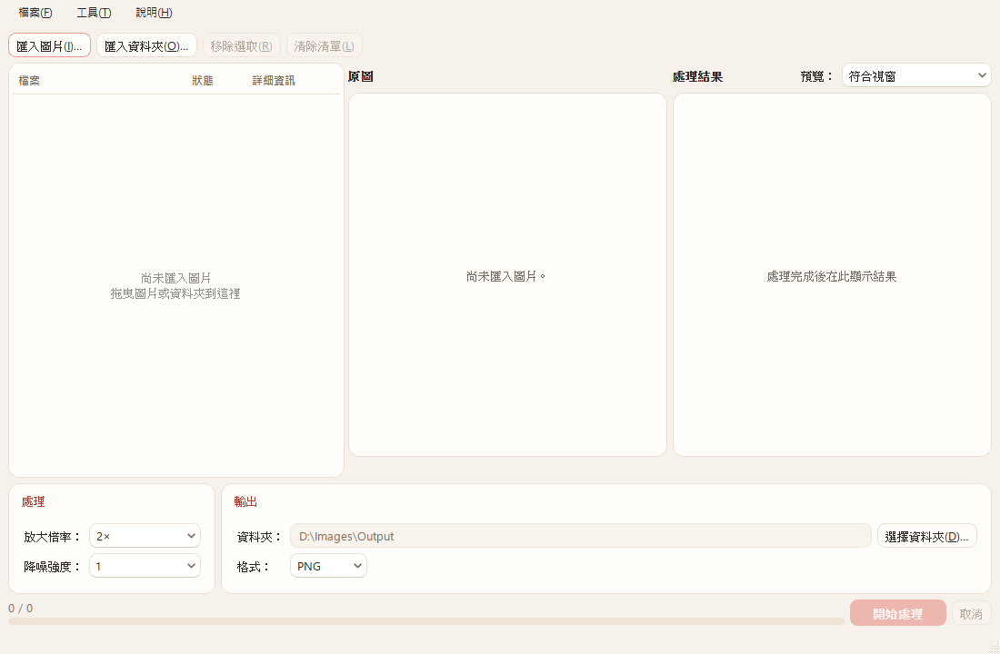 | 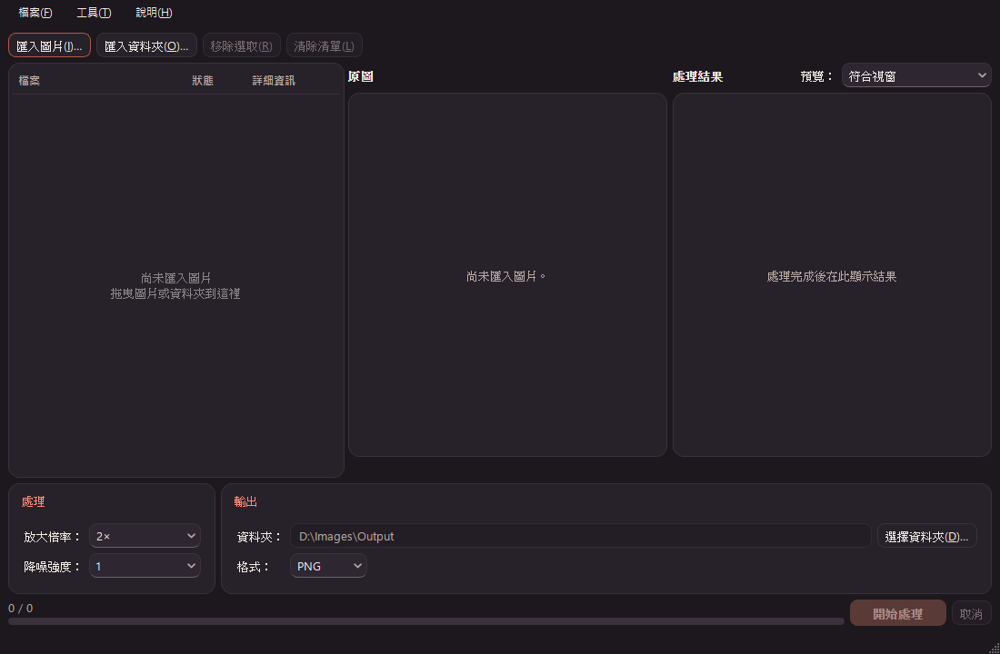 |
| 主視窗 ja | 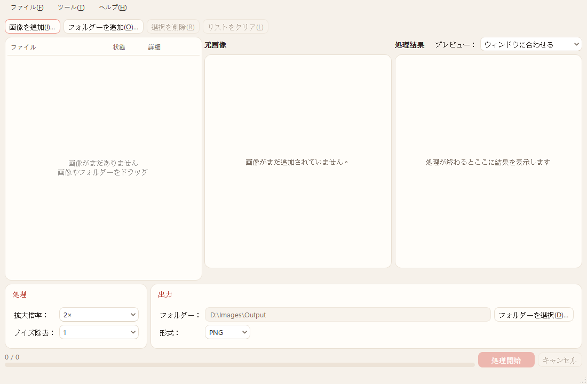 | 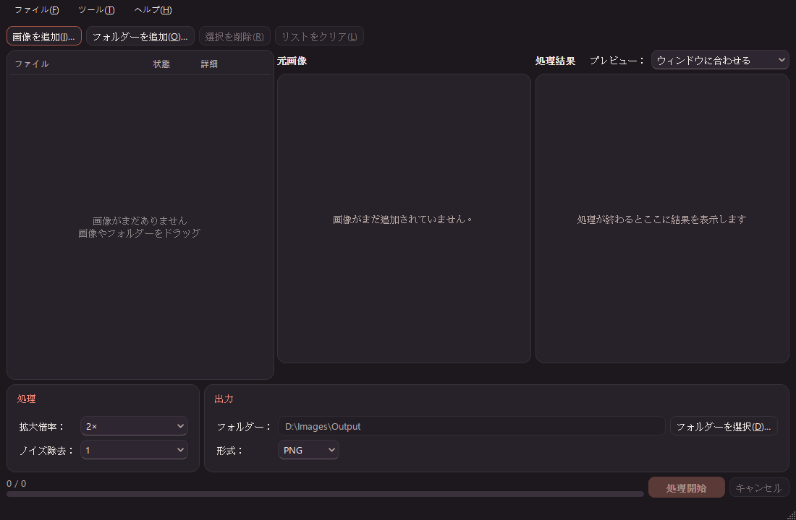 |
| 主視窗 en | 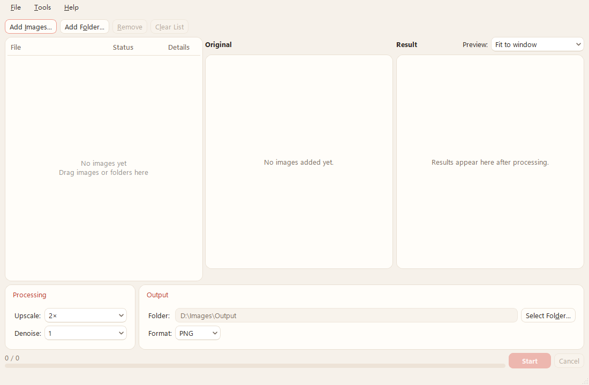 | 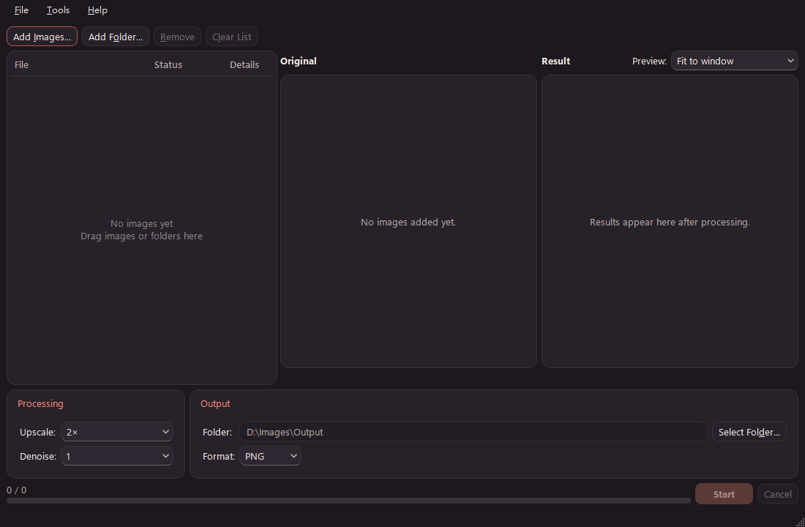 |
| 設定 zh_TW | 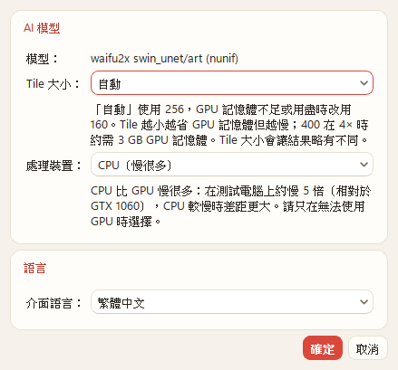 | 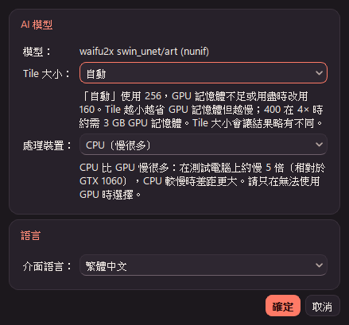 |
| 設定 ja | 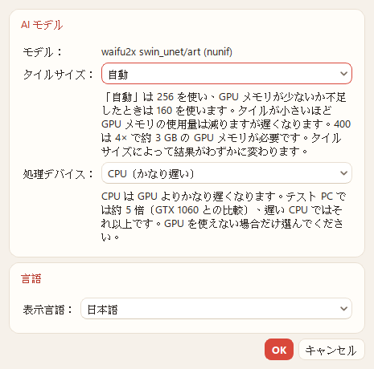 | 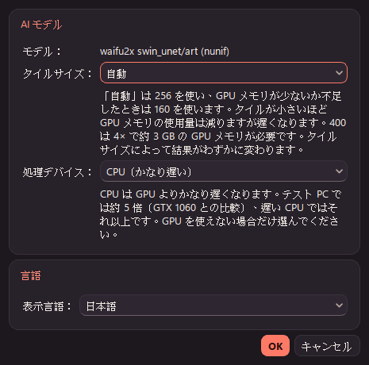 |
| 設定 en | 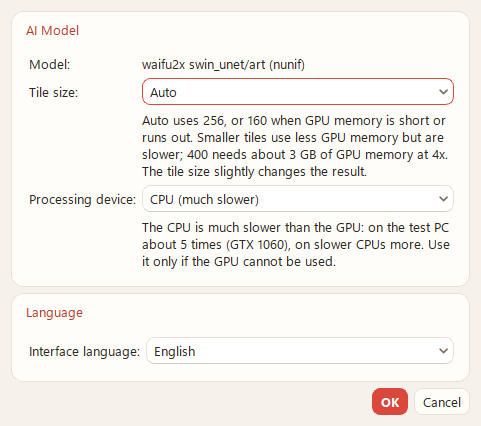 | 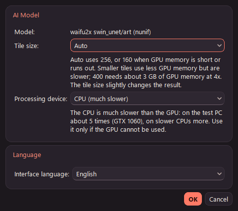 |
| 關於 zh_TW | 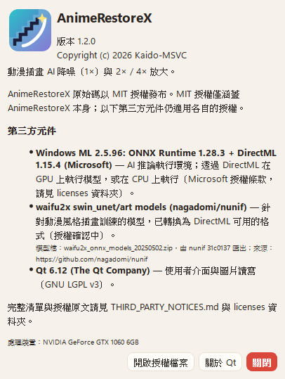 | 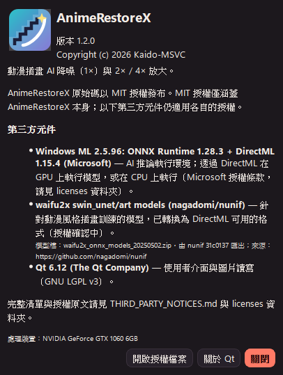 |
| 關於 ja | 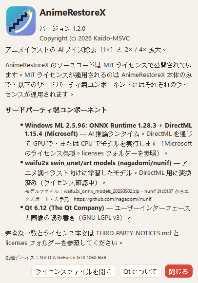 | 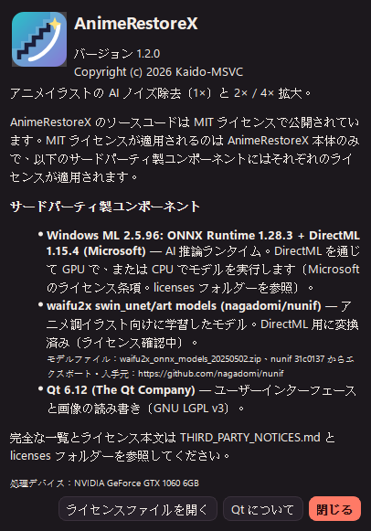 |
| 關於 en | 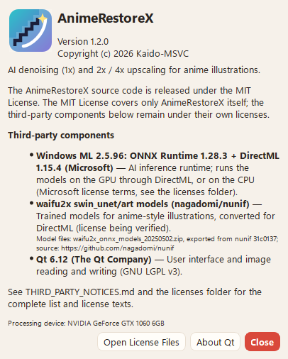 | 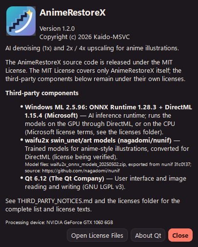 |

測試行程裡沒有初始化 runtime，所以關於視窗的截圖沒有「AI 執行環境：…」那一行；app 實際執行時會顯示（P3 的 staging 啟動已確認）。

### 4.4 未執行

| 項目 | 原因／現有涵蓋 |
|---|---|
| 「VRAM 不足改用 160」「OOM 後以 160 重做」的狀態文字在 UI 上實際顯示 | GTX 1060 6GB 不會觸發（P3 也沒有觸發過真正的 OOM）。邏輯由 `tst_pipeline` 的 `smallGpuBudgetUses160`、`oomRetriesWithSmallerTile`（假 Backend）涵蓋；字串已翻譯並通過佔位符檢查 |
| 「正在完成目前檔案的編碼」在 UI 上實際顯示 | `cancelThroughMainWindow` 是在推論中取消。編碼中取消的行為由 P3 `arx_verify` 實測（約 6 s，不留下檔案）；UI 只依目前階段選擇文字，沒有另外截圖 |
| Windows 10、其他 GPU | 沒有這些環境（README 已列為未測） |

## 5. README 的內容摘要

- **最低 OS**：取實測與元件要求的交集。保證可用的是 **Windows 11 x64**（實測 25H2 build 26200）；Windows 10 1903（18362）以上是元件允許的範圍（Windows ML 2.5.96 nuspec／README：Windows 10 19H1+；Qt 6.12：Windows 10 1809+／11，而且 6.12 是最後一個支援 Windows 10 的版本），但**未測試**。
- **GPU**：DirectX 12 GPU（這是 DirectML 的一般要求，P4 沒有另外查證），**已測只有 GTX 1060 6GB**；VRAM 需求表（P1／P2 實測）。
- **RAM**：**建議 8 GB**（4× 有透明時峰值約 2.1 GB）。
- **CPU 模式**：約慢 5 倍。
- **未測平台**：AMD／Intel GPU、6 GB 以下、多 GPU、Windows 10、ARM64、遠端桌面與 VM。
- **已知限制**：編碼中取消要等編碼完成（最多約 6 s）；tile 大小會影響輸出；每批第一張比較慢；DML 用過之後約 280 MB 的固定殘留；與 v1.2 共用部分設定。

## 6. P5 待決事項

| # | 事項 | 現況／需要的決定 |
|---|---|---|
| 1 | **Windows ML 授權 §3(b)(ii) 的散布方式** | P0 已記錄這一條（套件 `license.txt`）；P4 沒有重新閱讀條文。需要決定：把 DLL 放進 zip 一起散布（要符合 §3(b)(ii) 的條件與通知），或讓使用者另外取得 runtime。這會影響封裝與 THIRD_PARTY_NOTICES |
| 2 | **模型授權** | manifest 仍是 `license: UNRESOLVED`（P0 §5：GitHub MIT 與 HF AGPL 的標示衝突）。釐清之前不得封裝發布（規劃 §P0）。也要一併決定是否換成 swin_unet_v3_art（換代要重做 P0／P1） |
| 3 | **封裝 allowlist** | `tools/package.ps1`、`THIRD_PARTY_NOTICES.md.in`、`licenses/`、`packaging/README.txt` 還是 waifu2x-ncnn-vulkan 的內容。要改成乾淨的 staging 加上明確的檔案清單：exe、Qt DLL／plugins（windeployqt）、`onnxruntime.dll`、`DirectML.dll`、`models/manifest.json` 與 14 個模型、LICENSE／NOTICES／licenses。`build/release/waifu2x/` 這類殘留不得進包；封裝後要逐一比對雜湊 |
| 4 | 4× 有透明時的 RAM 用量（依 RAM 決定 Session 排程） | P3 §7 #4，P5 前可再評估 |
| 5 | 編碼中取消的延遲 | 目前只在文件與狀態文字中說明；是否改成可中斷的編碼路徑留待之後決定 |

## 7. 查過的文件

- Context7 `/websites/doc_qt_io_qt-6`：
  - `qt_add_translations`／`qt_add_lupdate`（`update_translations` target、`LUPDATE_OPTIONS`）與複數形
  - `QSettings::setPath`（只對 IniFormat 有效、不影響已建立的物件）、`setDefaultFormat`、`beginGroup`／`childGroups`／`remove("")` 的群組語意
  - Qt for Windows 支援的平台（Qt 6.12：Windows 10 1809+／11 x86_64；6.12 是最後一個支援 Windows 10 的版本）
- 本機套件：`third_party/windowsml/2.5.96/Microsoft.Windows.AI.MachineLearning.nuspec` 與 `README.md`（最低 OS Windows 10 19H1，build 18362）、`build/native/*.targets`（`TargetPlatformMinVersion` 檢查 10.0.18362.0）。
- Win32 `GetFileVersionInfoW`／`VerQueryValueW`（DirectML 版本）是穩定的 API，以本機 Windows SDK 的 `winver.h` 為準，沒有另外查。
