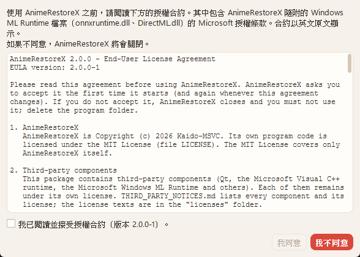
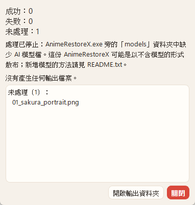
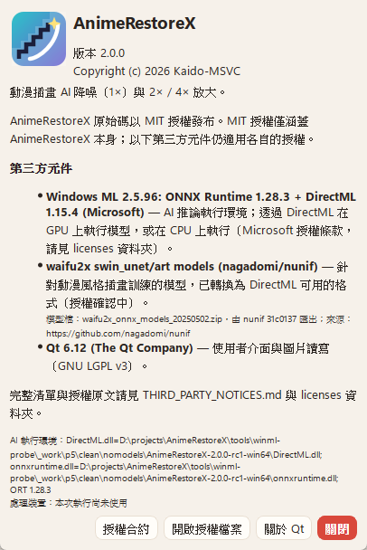
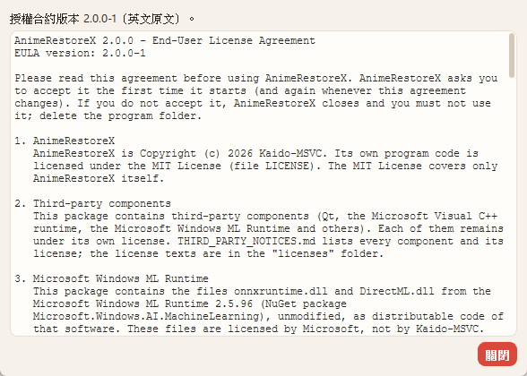
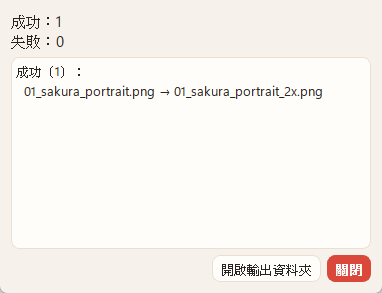
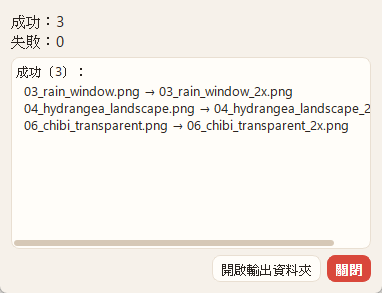

# AnimeRestoreX v2.0 — P5 報告（發布候選：封裝、授權、部署驗證）

- 日期：2026-11-03～04；分支 `v2.0-prep`
- commit：`c2093f3`（EULA、版本 2.0.0、封裝、通知）、`85d8c79`（package.ps1 語法修正）、本報告的 commit
- 環境：Windows 11 Home 25H2 build 26200、GTX 1060 6GB、Windows ML 2.5.96（ORT 1.28.3、DirectML 1.15.4）、Qt 6.12.0 msvc2022_64、MSVC 14.51.36231、CMake 4.4.4
- 沒有動標籤、Release、`main`，也沒有推送遠端；`dist/` 中 v1.x 的檔案（含 1.2.0 的 `SHA256SUMS.txt`）沒有被覆寫。

## 1. 判定

**技術上可以成為發布候選（RC1），但現在還不能對外發布。**

| 項目 | 結果 |
|---|---|
| 停止條件「條文有 ZIP 散布無法滿足的要求」 | **未觸發**，但有兩處要你判斷（§2.3）：§3(a)(i) 的文字寫的是「WindowsAppSDK NuGet package」；§3(b)(iii) 的賠償責任落在散布者（你）身上，與封裝形式無關 |
| 停止條件「封裝內有 allowlist 以外的檔案」 | **未觸發**。兩個封裝都通過 allowlist 檢查；另外刻意放入異常檔案做負向測試，檢查確實會擋下（§3.3） |
| 停止條件「乾淨環境無法啟動」 | **未觸發**。Windows Sandbox 在本機不可用（Home 版），改用最小環境近似測試，可啟動、可處理（§4） |
| 發布的阻礙 | **模型授權仍是 UNRESOLVED**。預設封裝不含模型，所以不能處理圖片；含模型的封裝只能當內部測試用 |

可以交給你決定的狀態：

- `dist/AnimeRestoreX-2.0.0-rc1-win64.zip`（不含模型）：所有檢查通過。內容不含授權未定的資產，但**單獨使用無法處理圖片**。
- `tools/winml-probe/_work/p5/AnimeRestoreX-2.0.0-rc1-win64-with-models-INTERNAL.zip`（含 14 個模型）：只供內部測試，**不得散布**（名稱與 MANIFEST 都有標示，也不會寫進 `dist/`）。

## 2. Windows ML 授權 §3（散布條款）

來源：`third_party/windowsml/2.5.96/license.txt`（NuGet `Microsoft.Windows.AI.MachineLearning` 2.5.96，SHA-256 `66395f8c…0c376814`，與 `licenses/WindowsML/license.txt` 逐位元相同）。以下只引用條文，「對照」欄是本專案的做法，**不是法律意見**。

### 2.1 條文摘錄

> 3. DISTRIBUTABLE CODE. The software may contain code you are permitted to distribute (i.e. make available for third parties) in applications you develop, as described in this Section.
>
> a) Distribution Rights. The code and test files described below are distributable if included with the software.
> i. Any files that are binplaced with your application by the WindowsAppSDK NuGet package are, by definition, permitted to be redistributed. This applies to both framework package dependent and self-contained deployments.
> ii. Image Library. You may copy and distribute images, graphics, and animations in the Image Library as described in the software documentation; and
> iii. Third Party Distribution. You may permit distributors of your applications to copy and distribute any of this distributable code you elect to distribute with your applications.
>
> b) Distribution Requirements. For any code you distribute, you must:
> i. add significant primary functionality to it in your applications;
> ii. require distributors and external end users to agree to terms that protect it and Microsoft at least as much as this agreement; and
> iii. indemnify, defend, and hold harmless Microsoft from any claims, including attorneys' fees, related to the distribution or use of your applications, except to the extent that any claim is based solely on the unmodified distributable code.
>
> c) Distribution Restrictions. You may not:
> i. use Microsoft's trademarks or trade dress in your application in any way that suggests your application comes from or is endorsed by Microsoft; or
> ii. modify or distribute the source code of any distributable code so that any part of it becomes subject to any license that requires that the distributable code, any other part of the software, or any of Microsoft's other intellectual property be disclosed or distributed in source code form, or that others have the right to modify it.

相關的其他條款：

> 4. … you will not … c) remove, minimize, block, or modify any notices of Microsoft or its suppliers in the software; … e) share, publish, distribute, or lease the software (except for any distributable code, subject to the terms above), provide the software as a stand-alone offering for others to use, or transfer the software or this agreement to any third party.
>
> 2. a) Data Collection. The software may collect information about you and your use of the software, and send that to Microsoft. …

### 2.2 逐條對照（免安裝 ZIP 散布）

| 條文 | 要求 | 本專案的做法 | 狀態 |
|---|---|---|---|
| §3(a)(i) | 由 NuGet 套件放到 app 旁的檔案可以再散布 | 散布的 `onnxruntime.dll`、`DirectML.dll` 正是這個套件的 `runtimes/win-x64/native/` 檔案，套件的 `.targets` 也是把它們放到 app 旁；未修改，雜湊與 `models/manifest.json` 的 `runtime` 一致 | **有歧義**（§2.3 #1） |
| §3(a)(iii) | 可以允許你的散布者再散布 | EULA §4：只能完整、不修改地轉送整個資料夾，接收者也必須同意 EULA | 已處理 |
| §3(b)(i) | 要為其增加重要的主要功能 | DLL 只作為 AnimeRestoreX 的推論後端，不是單獨提供 | 已處理（判斷「重要的主要功能」屬於你） |
| §3(b)(ii) | 要求散布者與最終使用者同意保護程度不低於本協議的條款 | 第一次啟動（及 EULA 版本變更後）顯示 EULA，必須勾選並按「我同意」才會繼續；**同意前不寫入任何設定，也不載入這兩個 DLL**。EULA §3 讓使用者同意 Microsoft 條款，附錄 A 收錄全文；§4 要求轉送者與接收者也同意 | 已實作；EULA 文字請你審閱 |
| §3(b)(iii) | 散布者要對 Microsoft 負賠償與防禦責任（僅基於未修改的 distributable code 的請求除外） | 這是散布者本人的義務，**無法透過封裝或 EULA 轉移或滿足** | **需要你決定是否接受**（§2.3 #2） |
| §3(c)(i) | 不得以暗示來自 Microsoft 或獲其背書的方式使用其商標 | 程式與文件只以文字說明元件名稱；NOTICES §3 註明「與 Microsoft 沒有隸屬關係，也未獲其背書」 | 已處理 |
| §3(c)(ii) | 不得讓 distributable code 受到要求公開原始碼的授權約束 | DLL 原樣散布、動態載入；AnimeRestoreX 為 MIT。Qt 是 LGPLv3，但 LGPL 適用於 Qt 本身，不會讓 Microsoft DLL 必須公開原始碼（這是我的理解，非法律意見） | 請你確認 |
| §4(c) | 不得移除或修改 Microsoft 的通知 | 套件的 `license.txt`、`ThirdPartyNotices.txt` 原樣放在 `licenses/WindowsML/` | 已處理 |
| §4(e) | 不得單獨散布或作為獨立產品提供 | EULA §3(b)、§4 與 README.txt 明文禁止單獨散布這兩個 DLL | 已處理 |
| §2(a) | 該軟體可能收集資料傳給 Microsoft | EULA §3(e)、§7 與 NOTICES §3 告知 | 已告知；ORT／DirectML 實際是否送出資料**未調查**（本次觀察到程式沒有任何 TCP／UDP 端點，§4.2） |

### 2.3 有歧義、需要你判斷的地方

1. **§3(a)(i) 的套件名稱**：條文寫「binplaced … by the WindowsAppSDK NuGet package」，但這份 license.txt 隨附的是 `Microsoft.Windows.AI.MachineLearning` 套件（README 提到較舊的 Windows 10 要改用 `Microsoft.WindowsAppSDK.ML`）。這個套件的檔案是否同樣適用 (a)(i)，條文沒有直接說明。條款開頭的「The software may contain code you are permitted to distribute」與 (b) 的「For any code you distribute」都假設有可散布的部分，但沒有列出檔案清單。**我沒有做結論。** 如果需要更確定，可以向 Microsoft 詢問，或查 Windows App SDK 的再散布說明。
2. **§3(b)(iii) 賠償責任**：由散布者本人承擔，與 ZIP 或安裝程式的形式無關。因此不屬於「ZIP 散布無法滿足」的停止條件，但只要散布就會承擔這項責任，要不要承擔由你決定。
3. **§3(b)(ii) 的「agree」**：本專案的做法是點擊同意（click-through）。這種方式是否足以構成「同意」，取決於當地法律與條文解讀，我沒有做結論。
4. **§1(a)**：條款授予「開發者」的是開發與測試的使用權；最終使用者的使用權則依賴 §3 與我們的 EULA 轉授。EULA §3 的寫法是讓最終使用者「同意 Appendix A 的條款」。這種結構是否妥當，請你審閱。

### 2.4 EULA 的實作

- 文字：`packaging/EULA.txt.in` 包含 AnimeRestoreX 條款 §1–§7，附錄 A 是 Microsoft 條款全文。CMake 讀取 `licenses/WindowsML/license.txt`，產生 `EULA.txt`。產生的檔案統一用 LF 換行（原文的 CRLF 已正規化，文字本身未修改；`tst_ui` 與 `package.ps1` 都會比對附錄 A 與原文是否一致）。
- 版本：`ARX_EULA_VERSION = "2.0.0-1"`（CMakeLists.txt）。同意後寫入 `v2/eula/acceptedVersion`；版本不同或沒有值時會再次詢問（`EulaDialog::isAccepted`）。
- 流程（`src/main.cpp`）：用只讀方式取得語言，接著顯示 EULA。同意後才建立 `AppSettings`（也就是才執行遷移、寫入設定），再載入 `onnxruntime.dll`、`DirectML.dll`。拒絕、按 Esc 或關閉視窗時，結束程式（exit code 0）。
- 介面：三種語言都有翻譯（標題、說明、勾選框、「我同意／我不同意」、儲存失敗訊息、檢視模式說明）；條款本身保留英文原文。「我同意」要先勾選勾選框才能按；預設按鈕是「我不同意」。
- 「關於」視窗新增「授權合約」按鈕，以唯讀方式顯示同一份內嵌文字。封裝內另有相同內容的 `EULA.txt`。
- **EULA 條文是我起草的，請你審閱後再發布**。特別是 §3 對 Microsoft 條款的摘要、§4 的轉送條件、§5 的免責範圍。

## 3. 封裝

### 3.1 `tools/package.ps1`（重寫）

```
pwsh -File tools/package.ps1 -Suffix rc1                 # dist\AnimeRestoreX-2.0.0-rc1-win64.zip
pwsh -File tools/package.ps1 -Suffix rc1 -IncludeModels  # _work\p5\…-with-models-INTERNAL.zip
```

1. 建置：在 `.package\build` 從頭 configure／build（`--preset release -B .package\build -DARX_BUILD_TESTS=OFF`，每次先刪除）。不會從 `build\` 或 `dist\` 撿取任何檔案。
2. staging：`.package\stage\<名稱>` 每次重建，檔案來源只有：乾淨建置（exe、`EULA.txt`、`THIRD_PARTY_NOTICES.md`）、windeployqt（Qt 6.12.0 安裝）、VS 2026 VC redist、Windows ML 套件、`third_party\models`（只有 `-IncludeModels` 時），以及 git 追蹤的 `LICENSE`、`packaging\README.txt`、`models\manifest.json`、`licenses\`（有未追蹤的檔案時拒絕）。
3. 檢查，任一項失敗就不產生 zip：
   - **allowlist**：檔案集合必須完全等於明列的清單（21 個程式與文件檔、git 追蹤的 51 個授權檔、`-IncludeModels` 時再加 14 個模型），不能多也不能少，而且每個檔案都要有記錄來源。
   - **禁止名稱**：`waifu2x`、`ncnn`、`cunet`、`vcomp1xx`、`.param`、`.bin`、`Microsoft.Windows.AI.MachineLearning.dll`、`opengl32sw`、D3D／DXC 編譯器、`Qt6Svg`、`Qt6Network`、`vulkan-1`；沒有 `-IncludeModels` 時，出現任何 `.onnx` 都算錯誤。我方文件（README、NOTICES、EULA、manifest）的內容也不得出現 `ncnn`、`models-cunet`、`vcomp140`、`Vulkan GPU`。
   - **逐位元一致**：每個複製來的檔案都與來源雜湊相同（Qt DLL 也比對安裝目錄的原檔，確認 windeployqt 沒有修改）。
   - **runtime**：`onnxruntime.dll`、`DirectML.dll` 的產品版本與 SHA-256 必須等於 `models/manifest.json` 新增的 `runtime` 區段（ORT 1.28.3／DirectML 1.15.4）。
   - **模型**：與 manifest 的 SHA-256 一致；manifest 的授權是 UNRESOLVED 時，`status` 也必須標示授權未解決。
   - **版本**：NOTICES 標題是 2.0.0；EULA 的開頭與版本正確，沒有殘留的 `@…@`，附錄 A 與原文一致。
   - **依賴**：用 `dumpbin /dependents` 檢查所有 exe／dll 的匯入（含延遲載入），每一個都必須由封裝提供或屬於 Windows（`api-ms-win-*` 或 System32）。CRT、Qt、ORT、DirectML 不可以靠 System32 提供。
4. `MANIFEST.txt`（每個檔案的 SHA-256、大小、來源）→ zip → **重新解壓並逐一比對雜湊** → 確認 Qt 原始碼 zip 的雜湊 → `SHA256SUMS-<名稱>.txt`（為了不覆寫 1.2.0 的 `SHA256SUMS.txt`，改用這個檔名）。
5. 含模型且授權 UNRESOLVED 時：輸出到 `tools\winml-probe\_work\p5\`，名稱加上 `-with-models-INTERNAL`，MANIFEST 標題加註「NOT FOR DISTRIBUTION」。

### 3.2 與你指示的差異

- **Windows ML runtime 只附 2 個 DLL，不是 3 個**。`Microsoft.Windows.AI.MachineLearning.dll` 是 Windows ML API／EP catalog（套件的 CMake 說明：`WindowsML::Api`）。本程式只連結 `WindowsML::OnnxRuntime`，`dumpbin` 顯示 exe 與 `onnxruntime.dll` 都不匯入它，P3／P4 的執行也從未載入它。依「只放必要檔案」的原則，它列在禁止清單中。如果你仍然要放進去，改 allowlist 一行即可，但要說明它的用途。
- **VC runtime 要附**：`AnimeRestoreX.exe` 與 Qt DLL 匯入 `msvcp140*`、`vcruntime140*`（`onnxruntime.dll`、`DirectML.dll` 不需要）。依 VS 2026 的 Distributable Code 條款，以 app-local 方式附上 5 個 DLL（與 v1.2 相同）。
- 模型 runtime 的版本「與 manifest 一致」：我在 `models/manifest.json` 新增 `runtime` 區段（套件、版本、nupkg 雜湊、兩個 DLL 的版本與 SHA-256）。程式的 manifest 讀取器會忽略未知欄位，`tst_inference_core` 也已重跑並通過。

### 3.3 負向測試（檢查是否真的會擋下）

用暫時複製的 package.ps1（測完已刪除）在檢查之前放入：v1.2 的 `waifu2x\vcomp140.dll`、一個多餘的 `stray.txt`，以及把 `DirectML.dll` 換成 arm64 版本。結果：**7 個問題，沒有產生 zip**。

```
not in allowlist: stray.txt
not in allowlist: waifu2x\vcomp140.dll
no recorded origin: stray.txt
no recorded origin: waifu2x\vcomp140.dll
forbidden file: waifu2x\vcomp140.dll
differs from its source: DirectML.dll
DirectML.dll: SHA-256 differs from models\manifest.json
```

### 3.4 檔案清單與 SHA-256

`AnimeRestoreX-2.0.0-rc1-win64.zip`（不含模型）：73 個檔案（21 個程式與文件檔＋51 個授權檔＋`MANIFEST.txt`），zip 30,684,748 bytes。

| SHA-256 | 大小 | 路徑 | 來源 |
|---|---:|---|---|
| `5bb38f38c4ed292ba59914bc0d0c5fd6e4a0e21a214db501cd8e1d0e78f1de85` | 706,048 | `AnimeRestoreX.exe` | 乾淨 Release 建置 |
| `f4904f839c48216fa98c83847a9eb8ded25e3258105630cad98916329a0538ef` | 23,579,512 | `onnxruntime.dll` | Windows ML 2.5.96（未修改） |
| `82c6e345cc62a9d1e06874aac4e3e1f990432a2baeae5888477933e26b2c0894` | 18,700,648 | `DirectML.dll` | 同上 |
| `39175459c4837c8cc0f709a637fb6eadb25d696785109c8393559ec876f02703` | 10,472,760 | `Qt6Core.dll` | Qt 6.12.0 官方（與 1.2.0 相同） |
| `37c79b48b9cc2d9a03d21410c26fea683d236f9280f5c9aaab85d980759f2835` | 9,683,256 | `Qt6Gui.dll` | 同上 |
| `74138ca203c378a62367cc398e4dac07dec729b5a121486dbb26109854c17ae5` | 6,520,120 | `Qt6Widgets.dll` | 同上 |
| `12eef54bcdb6711b2722e9cef983d91a54546565a96b684d7bd9e2a7370fde92` | 1,001,784 | `platforms\qwindows.dll` | 同上 |
| `9e67dc18c9f67141f5da20646b63a5ee4a57f8cfdad6b1b3c4c5f70e49ace065` | 592,696 | `imageformats\qjpeg.dll` | 同上 |
| `237afef6be8253fd57559516b2ba2dbeafdccb72b7416ad41f9fd15548f75172` | 566,072 | `imageformats\qwebp.dll` | 同上 |
| `2b9581c69b975f59be505b127cd3c19d403ef3d12e0e8386fb97238223e9c1df` | 129,913 | `translations\qt_ja.qm` | windeployqt 合併 |
| `21012b2b427f8d09d31ce9cae582ca27955b478ca3dc2ec18a3068d808638c6a` | 126,185 | `translations\qt_zh_TW.qm` | 同上 |
| `7c26614e1d733892c2deac7e245ce115504b1d80592dd0a01b08e3e5a55f89ca` | 643,512 | `msvcp140.dll` | VC redist 14.51.36231 |
| `206c931bf90fdad8816de3b5e2ef80b2bcaa9406c89ecc05fe6fddffe251e982` | 35,768 | `msvcp140_1.dll` | 同上 |
| `d50d7883f20d1dc6191768d3746f52dd9cac89c346ffaed5be1f110c2f34a838` | 274,872 | `msvcp140_2.dll` | 同上 |
| `d1f4225df2cd877dbf130d5668a021dce3f94118455ff5ec952061c30afc9ce7` | 178,616 | `vcruntime140.dll` | 同上 |
| `a7146c08f89fe5b04541ab507cdb59ff7b44534d4ba3c668a426c6450a03434e` | 50,112 | `vcruntime140_1.dll` | 同上 |
| `edeeba43ac8ba30d8894c0cd7ad83ac7c603ca209b9ca06a897cf4373ce6ae68` | 16,968 | `models\manifest.json` | 本專案 |
| `a00b4c539e0cbae6437712a16c67a74aa9d92f853f0bb7209435ac23e64ae495` | 18,126 | `EULA.txt` | 本專案（CMake 產生） |
| `806e52dd7e627ebdfb1b327e312f33574bcb4c083f8a5c2362123a01102cdc82` | 11,147 | `THIRD_PARTY_NOTICES.md` | 本專案（CMake 產生） |
| `92c6f4e713100bd9f894ba991aa0b38c1f7dc9f52f05ccad146a86b39de4d525` | 6,490 | `README.txt` | 本專案 |
| `2e4363e4261654cf8c6ff05e958282969799133ccc03513dec77fcd0f4987478` | 1,509 | `LICENSE` | 本專案 |
| （51 個檔案） | | `licenses\…` | `Qt\`、`WindowsML\`、`nunif\`、`README.md`；雜湊列在封裝內的 `MANIFEST.txt` |

`SHA256SUMS-AnimeRestoreX-2.0.0-rc1-win64.txt`：

```
58beb8614f0fe21d52f6062cd30489ebfae944b3852a693a856425f01b1a0ea3  AnimeRestoreX-2.0.0-rc1-win64.zip
0529901575c413e34ded504eeda177c4a6dfd0dff1e39ed52c811dc5204b43c7  qtbase-everywhere-src-6.12.0.zip
664de2ba60a1e74105da844c061688ff5e6f8f046d5dd98e2d6b6ad3c553b4ca  qtimageformats-everywhere-src-6.12.0.zip
286f0ca3ad669bc2d6fec0e209a797a08049d037c7a167e60eb3b4a640405aa5  qttranslations-everywhere-src-6.12.0.zip
```

內部封裝（含模型）：87 個檔案，zip SHA-256 `01d63fbe982023da3aa6ea7257659bd4043a2ddcb239aa6aba4e9513bf03ad1a`。額外的 14 個 `models\swin_unet\art\*.onnx` 雜湊與 `models/manifest.json` 一致（例如 `noise1_scale2x.onnx` = `afa6a24c…eea0caa`）。

`dumpbin` 的依賴報告在 `.package\dependencies-<名稱>.txt`（不進 git）。所有非封裝內的匯入都屬於 Windows：`d3d12`、`dxgi`、`d3d11`、`d3d9`、`DWrite`、`icuuc`、`UIAutomationCore`、`api-ms-win-*` 等。

## 4. 授權與通知

- `THIRD_PARTY_NOTICES.md.in`：依實際封裝內容重寫 §1。§2（Qt LGPL、對應原始碼一起發布、可替換 Qt DLL）**原文保留**。新增 §3 Windows ML Runtime（來源、雜湊、條款位置、限制、只用 ORT C API 與 DirectML、不下載 EP、商標聲明）和 §4 nunif 模型（來源、Pad→Slice 改寫、**授權待確認**、預設封裝不含模型）。§5 VC runtime 改寫依賴說明。§6 說明 Qt 內的 Vulkan 相關程式碼通知仍保留在 §2。
- `licenses/`：刪除 `waifu2x-ncnn-vulkan`、`ncnn`、`glslang`、`libwebp`（頂層）、`libjpeg-turbo`、`libpng`、`zlib-ng`、`dirent`、`waifu2x-models`。新增 `WindowsML/license.txt`、`WindowsML/ThirdPartyNotices.txt`（套件原檔，`collect-licenses.ps1` 會核對雜湊），以及 `nunif/LICENSE`、`nunif/NOTICE`（nagadomi/nunif @ `31c0137`，也就是模型匯出時的 commit）。**Qt 使用的授權（含 Qt 內的 libwebp、libjpeg、libpng、zlib、Vulkan 相關）全部保留**；重跑 `collect-licenses.ps1` 後，`licenses/Qt` 與先前逐位元相同。
- `packaging/README.txt` 改寫為 2.0：需求、模型說明、首次同意流程、已知限制、移除方式，以及轉送規則（不得單獨散布 DLL）。程式未簽章時 SmartScreen 可能會警告，也寫在裡面。
- 缺少模型的訊息改為：「AnimeRestoreX.exe 旁的「models」資料夾中缺少 AI 模型檔。這份 AnimeRestoreX 可能是以不含模型的形式散布；新增模型的方法請見 README.txt。」（三種語言）
- 版本：CMake `project(... VERSION 2.0.0)`。「關於」視窗與 NOTICES 都顯示 2.0.0（§5 截圖）。

## 5. 驗證

### 5.1 環境

- **Windows Sandbox：不可用**。本機是 Windows 11 Home（`C:\Windows\System32\WindowsSandbox.exe` 不存在）。也沒有 VM 或另一台電腦。
- 改用**本機最小環境近似測試**：把 zip 解壓到 `_work\p5\clean\`；啟動時把環境變數縮到 Windows 基本項目（`PATH` 只有 `System32`、`Windows`、`Wbem`，移除 Qt／VS／Strawberry 等），工作目錄設為 `C:\Windows`，並使用全新的 `--settings-dir`；以 UI Automation 與滑鼠操作程式。
- 這**不等於真正乾淨的電腦**：本機仍然裝有 VC redist、Qt、VS 與 GPU 驅動。不過已確認程式載入的 Qt、CRT、ORT、DirectML 都來自封裝資料夾（列出行程模組，見下表），沒有任何模組來自 Qt、VS 或 build 目錄。

### 5.2 結果

| # | 項目 | 封裝 | 環境 | 結果 |
|---|---|---|---|---|
| 1 | 解壓後直接啟動 | 不含模型 | 最小環境 | 通過：出現 EULA 對話框（zh_TW，依 Windows 語言）。此時 `onnxruntime.dll`／`DirectML.dll` **尚未載入**（0 個），設定資料夾是空的 |
| 2 | 首次同意對話框 | 不含模型 | 最小環境 | 通過：未勾選時「我同意」停用；勾選後啟用；同意後主視窗開啟，INI 只有 `[v2] schema=1`、`eula\acceptedVersion=2.0.0-1`。重新啟動不再詢問 |
| 3 | 拒絕同意 | 不含模型 | 最小環境 | 通過：「我不同意」→ 結束、exit code 0、設定資料夾 0 個檔案；按視窗關閉鈕也一樣 |
| 4 | 離線啟動 | 兩種 | 最小環境與一般環境 | **部分執行**：整個執行期間，行程沒有任何 TCP 連線與 UDP 端點（每次測試都檢查）；封裝內沒有 Qt Network 或 TLS 外掛。**實際中斷網路後啟動：未執行**（停用網卡需要系統管理員權限，也會改變系統設定） |
| 5 | 缺少模型時的提示 | 不含模型 | 最小環境 | 通過：匯入 1 張圖，開始處理 → 批次停止，完成摘要顯示「處理已停止：…缺少 AI 模型檔…請見 README.txt」，未處理 1、沒有產生輸出 |
| 6 | 處理一張圖（CPU） | 含模型 | 最小環境 | 通過：`01_sakura_portrait.png` 864×578，2×、降噪 1、Auto（t256）、CPU，14.3 s → 1728×1156。**與 P3 的 CPU 參考輸出像素完全相同** |
| 6b | 處理一張圖（GPU） | 含模型 | 最小環境 | 通過（額外）：`05_sunset_landscape.png` 2×、DML，7.1 s |
| 7 | 開發機：單張 | 含模型 | 一般環境 | 通過：`02_sunset_boy.png` 2×、DML，8.1 s（含冷啟動）。**與 P3 的 DML 參考輸出像素完全相同** |
| 8 | 開發機：小批次 | 含模型 | 一般環境 | 通過：3 張（含透明 `06_chibi_transparent.png` → 1332×864 ARGB）2×、DML，14.2 s，成功 3／失敗 0；估速以 `…@afa6a24c/dml/t256/x2` 與 `#cold` 記錄 |
| 9 | 「關於」→「授權合約」 | 不含模型 | 最小環境 | 通過：顯示「版本 2.0.0」、runtime 從封裝路徑載入；授權合約以唯讀方式開啟 |

沒有開啟檔案對話框的啟動（#1–#3）中，行程模組全部來自封裝資料夾或 `C:\Windows`。開啟過檔案對話框的執行，額外的模組只有 `tiptsf.dll`（Windows 手寫輸入）、MEGAsync 與 IDM 的殼層擴充。這些都是開啟檔案對話框時由 Windows 載入的本機軟體，不是程式的依賴。

GPU 執行時 ORT 會在 console 輸出 `VerifyEachNodeIsAssignedToAnEp` 警告（shape 相關節點放在 CPU）；這是 P1 起就有的已知訊息，GUI 版看不到。

截圖（`docs/v2.0-P5/`）：

| 首次同意 | 缺少模型 | 關於 |
|---|---|---|
|  |  |  |
| **授權合約（檢視）** | **CPU 一張（最小環境）** | **GPU 小批次（開發機）** |
|  |  |  |

### 5.3 自動測試

- `ctest --preset release`：**5/5 通過**（改了 `models/manifest.json`，所以 5 個都重跑）。
- `tst_ui` 新增 `licenseAgreement`，檢查：版本與 CMake 一致；內嵌文字等於建置產生的 `EULA.txt`；附錄 A 包含 `licenses/WindowsML/license.txt` 全文；沒有殘留的 `@…@`；舊版本會被要求重新同意；勾選後才能同意、拒絕回傳 Rejected、同意回傳 Accepted；檢視模式沒有同意按鈕；只讀函式不會寫入設定，同意後只寫入 `v2/`；「關於」的按鈕會開啟檢視模式；zh／ja 按鈕文字已翻譯，而條款仍是英文。
- 翻譯：lupdate 新增 9 筆（另有 1 筆舊的缺少模型字串被移除），zh_TW／ja 全部補齊，沒有控制字元。

### 5.4 未執行

| 項目 | 原因 |
|---|---|
| Windows Sandbox／真正乾淨的 Windows（沒有 VC redist、Qt、VS） | 本機是 Home 版，也沒有 VM。已用最小環境近似測試，並確認模組來源 |
| 中斷網路的實際離線啟動 | 需要系統管理員權限與修改系統設定；改以「沒有任何 TCP／UDP 端點」作為證據。如果需要，你可以拔掉網路線後執行 `_work\p5\clean\` 中的封裝驗證（約 1 分鐘） |
| 乾淨環境的 GPU 路徑 | 沒有乾淨環境；在最小環境下 GPU 可以執行（§5.2 #6b） |
| Windows 10、其他 GPU、ARM64 | 沒有這些環境（README 已列為未測） |
| 程式碼簽章 | 沒有憑證；README 寫明未簽章 |
| 從 `.package` 重新跑一次完整的 package.ps1（不加 `-SkipBuild`） | 第一次完整執行在建置完成後，因 package.ps1 的語法錯誤而中止；修正（只改腳本，沒有改程式）後，用 `-SkipBuild` 重用同一個乾淨建置產生兩個封裝。exe 對應 commit `c2093f3` 的原始碼 |

## 6. 尚未完成的發布條件（由你決定）

| # | 條件 | 現況 |
|---|---|---|
| 1 | **模型授權** | `models/manifest.json` 仍是 `license: UNRESOLVED`，`status: DRAFT`，正在等 nunif 回覆。確定之後要做的事：更新 manifest 的 `license`／`status`、NOTICES §4、README.txt 的模型段落、About 的「授權確認中」，然後用 `-IncludeModels` 產生正式封裝（授權確定後，腳本會寫到 `dist\`，名稱也不會再加 INTERNAL） |
| 2 | **Windows ML 條款的判斷** | §2.3 的四項（#1 套件名稱、#2 賠償責任、#3 click-through、#4 授權結構）；EULA 條文需要你審閱 |
| 3 | 是否散布不含模型的版本 | 技術上已通過檢查，但單獨使用無法處理圖片 |
| 4 | 合併 `main`、建立標籤、發布 Release | 沒有執行。發布時要一起上傳：zip、3 個 Qt 原始碼 zip、`SHA256SUMS-…txt` |
| 5 | 實際離線／真正乾淨環境 | §5.4 |

其他延後項目沿用 P4 §6：#4（4× 透明的 RAM 排程）、#5（編碼中取消）。

## 7. 查過的文件

- Context7 `/websites/cmake_cmake_help`：`cmake --preset` 搭配 `-B` 覆寫 binaryDir（3.21 起支援；命令列上的設定可以覆寫 preset）。
- 本機套件文件：`third_party/windowsml/2.5.96/license.txt`（§1–§4 全文）、`README.md`（Deployment、最低 OS、`Microsoft.WindowsAppSDK.ML`）、`build/cmake/microsoft.windows.ai.machinelearning-config.cmake`（`WindowsML::Api` 與 `WindowsML::OnnxRuntime` 的分工、DirectML 的部署）、`build/native/*.targets`（放到 app 旁的 3 個檔案）、`ThirdPartyNotices.txt`（開頭）。
- nunif `31c0137` 的 `LICENSE`、`NOTICE`（本機 git 與 raw.githubusercontent）。
- 沒有另外查的部分：`QPlainTextEdit`、`QCheckBox`、`QDialogButtonBox`、`QFontDatabase::systemFont`、`qt_add_resources`、`configure_file(... NEWLINE_STYLE)`、`file(READ)`／`string(REPLACE)`。這些都是專案已在使用，或屬於穩定的基本 API；行為以編譯和測試確認。Windows UI Automation（`System.Windows.Automation`）只用在驗證腳本，沒有查文件。
