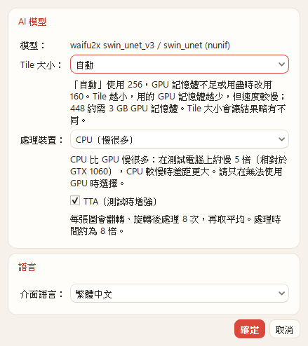
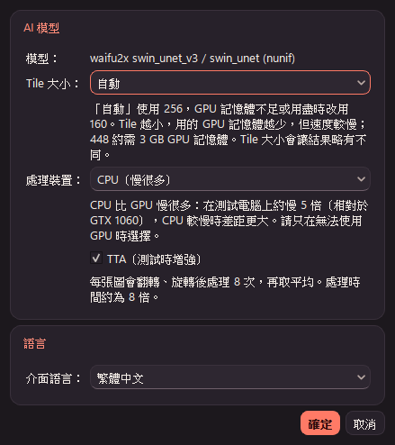
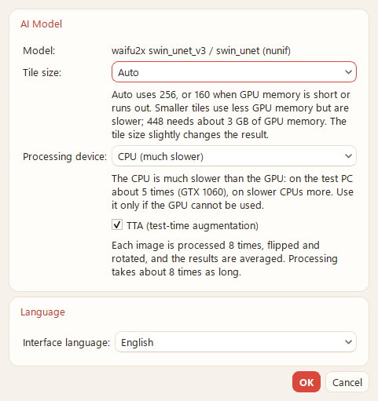
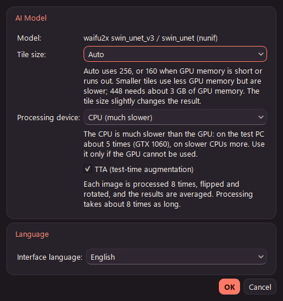
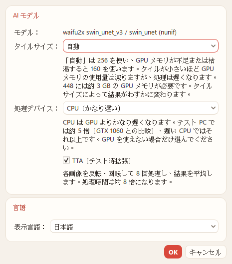
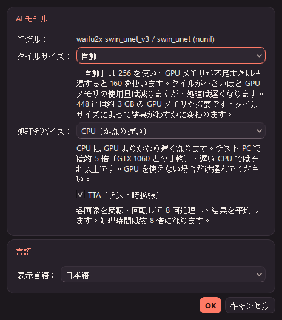

# AnimeRestoreX v2.1 — P2（TTA）報告

- 日期：2026-11-13
- 分支：`main`（未推送、未打 tag、未封裝；版本號維持 2.0.1）
- 依據：`docs/v2.0-交接.md`、`docs/v2.1-P0-P1報告.md`
- 環境：Windows 11 25H2、GTX 1060 6GB、MSVC 14.52.37025、`-std:c++23`、Qt 6.12.0、ORT 1.24.4 + DirectML 1.15.4；模型與 manifest 都未變動

## 1. 結論

| 項目 | 結果 |
|---|---|
| TTA 實作 | 照 nunif 0d3d92c 的 `Waifu2x.convert(tta=True)`：整張 RGB 依 `tta_split` 做 8 種變換，每種各跑一次完整的 tiled render（各自切 tile、做接縫混合、clamp），再照 `tta_merge` 反變換、依序加總、乘 1/8、clamp，最後 quantize256。alpha 不做 TTA |
| TTA 關閉 | 16 個案例對基準（v2.0.1）最大差 0，檔案逐位元組相同；P1 之後也是 0 |
| 單元測試 | 最近鄰假引擎：TTA 開啟與關閉的輸出相同（寬高不同、RGB、RGBA）；只有「完全透明像素的 RGB」最多差 1，原因與證明見 §4.1。8 種變換另外對照 torch 語意的翻轉／旋轉逐點核對 |
| 對 nunif CLI `--tta` | 4 個案例（2× v3、1× v3、4× 舊圖、透明 2×），8 位元最大差全部 1，沒有大於 1 的值（§4.3） |
| 時間 | 2400×1606 2× t256：TTA 關閉與 P1 相同（19.6–19.7 s）；TTA 開啟 113.4 s（5.8 倍） |
| 記憶體 | TTA 只多一個 float 累加緩衝區（每個輸出像素 12 bytes）。75 M 像素上限時，float 緩衝區由 1.2 GB 增加到 2.1 GB。實測 2400×1606 的峰值 private 多 176 MiB，與估算相符（§5） |
| ctest | release 5／5，debug 5／5；每個 commit 都跑過 release ctest |
| UI | 設定的「AI 模型」群組加入「TTA（測試時增強）」勾選框，預設關閉並註明處理時間約為 8 倍；完成清單在檔名後加上「（TTA）」；zh_TW／ja 翻譯已補上 |

## 2. 上游行為（nunif 0d3d92c）

| 行為 | 出處 |
|---|---|
| 8 種變換與順序：x、hflip、vflip、vflip→hflip、tr、tr→hflip、tr→vflip、tr→vflip→hflip | `nunif/transforms/tta.py:20-30`（`tta_split`） |
| hflip = `torch.flip(x, (2,))`（x 方向）、vflip = `torch.flip(x, (1,))`（y 方向）、tr = `torch.rot90(x, 1, (1, 2))`，反轉用 `rot90(x, -1, (1, 2))` | `tta.py:4-17` |
| 合併：`avg = x.clone()`，依 split 順序 `+=` 各份的反變換（先翻轉、再轉 −90°），`avg *= 1 / 8.0`，`clamp_(avg, 0, 1)` | `tta.py:33-46`（`tta_merge`） |
| 整張圖做 TTA，每一份各自 `render` → `tiled_render` | `waifu2x/utils.py:287-290` |
| 每份 render 的輸出先 clamp 到 [0,1] | `nunif/utils/seam_blending.py:41-42`（`get_output`） |
| alpha border padding 在 TTA 之前做一次；alpha 之後照一般流程處理，不做 TTA | `waifu2x/utils.py:281-286`、`295-309` |
| CLI 的 `--tta` 直接傳給 `convert` | `waifu2x/ui_utils.py:258`、`62` |

`rot90(x, 1, (1, 2))` 是逆時針轉 90°：`tr[i][j] = x[j][W-1-i]`，大小變成 W×H。程式中 8 種變換對應原圖索引的公式寫在 `TileProcessor.h` 的 `ttaMap`，`tst_inference_core` 的 `testTtaMap` 用 torch 語意明確寫出的翻轉與旋轉逐點核對（1×1、5×3、2×4、7×7）。

## 3. 實作

| 檔案 | 內容 |
|---|---|
| `TileProcessor.h/.cpp` | `ProcessOptions::tta`、`ProcessStats::tta`、`Progress::ttaVariant`、`ttaMap`。`tiledRender` 改成讀 `RenderSource`、寫 `RenderTarget`：TTA 關閉時是原本的擷取迴圈與 8 位元輸出（程式碼沒變）；TTA 時，經由索引映射讀取變換後的影像（不建變換後的複本），輸出則 clamp 後直接反變換寫進 float 累加緩衝區（第一份用指定、其餘用加總，順序與上游相同）。8 份都完成後 `×0.125`、clamp、quantize256 |
| `JobSpec.h`、`ProcessJob.cpp` | `InferenceOptions::tta`（JobSpec 是快照，處理中改設定不影響正在跑的工作）；`ItemResult::tta`；diagnostics 最後一行為 `tta: on (8 runs)` 或 `tta: off`，失敗時也有 |
| 進度與 ETA | `upscaleImage` 的總量是 RGB 算 8 份、alpha 算 1 份，tile 總數是 4×（原尺寸計畫）＋4×（轉置尺寸計畫）＋alpha。ETA 的 rate key 加上 `/tta`，與一般處理分開分組，推論工作量 ×8；項目權重（輸出像素）不變，所以批次進度比例不受影響。不開 TTA 時 key 與 P1 相同 |
| `AppSettings` | `v2/inference/tta`，只有存的值是 `true` 才算開啟；舊設定檔沒有這個鍵時視為關閉，不需要遷移 |
| `SettingsDialog`、`MainWindow` | 勾選框與說明；`applySettings` 多一個 `tta` 參數；完成清單顯示「（TTA）」 |
| `arx_verify` | `--job S:N:FMT:TILE[:cpu|gpu][:tta]`；item／end 事件加上 `peak_private_mib`（`PeakPagefileUsage`） |

- **寫法**：沿用 P1：`std::expected`；mdspan 只用來算每一列的起點；熱點迴圈不用逐元素的多維下標。TTA 的擷取迴圈是 `row[colOff[tx]]`，列起點為 `a + b*y`，欄位移為 `c*x`。
- **tile**：8 份用同一個 tile。轉 90° 的 4 份用 H×W 重新建 tile 計畫（`makeTilePlan(h, w)`）。
- **GPU 復原**：規則不變。Auto 在 256 遇到 OOM 或 DeviceLost 時，整張圖的 8 份全部改用 160 從頭重做，每批最多一次；單元測試讓第 4 份失敗來驗證這一點。
- **取消**：照舊在每個 tile 之間檢查。
- **alpha**：alpha border padding 在 8 種變換之前做一次；alpha 通道照原本的流程（1× 原樣保留，2×／4× 走 alpha 模型，不做 TTA）。

## 4. 驗證

### 4.1 單元測試（不需要 GPU）

| 測試 | 內容 | 結果 |
|---|---|---|
| `testTtaMap` | 8 種變換對照 torch 語意的翻轉／旋轉，逐點比對索引與大小 | 通過 |
| `testTtaMatchesPlain` | 最近鄰假引擎（和翻轉、旋轉可交換），1×／2×／4× × tile 64／160 × 6 種圖：37×23、257×131、1×70 的 RGB；131×61 的 RGBA（alpha 1–254）；131×61、90×170 的 RGBA（含 alpha=0 的欄）。同時檢查 RGB 呼叫數 = 4×(W×H 計畫) + 4×(H×W 計畫)、alpha 只跑 1 份、進度總量 = 輸出像素×(8+alpha)、最後一次進度等於總量 | 通過 |
| `testTtaRetryAndCancel` | 第 4 份第 1 個 tile OOM → 重建一次，8 份全部用 160 重做，輸出正確；第 10 個 tile 取消 → Cancelled，沒有圖，alpha 沒有執行 | 通過 |
| `tst_pipeline::ttaThroughTheJob` | 經過 ProcessJob：`ItemResult::tta`、diagnostics、Run 次數為 8 倍、輸出與關閉時相同 | 通過 |
| `tst_core`、`tst_ui` | 設定的儲存與讀回、壞值（`"yes"`）視為關閉、ETA key 與工作量、設定頁勾選框與說明 | 通過 |

**透明像素的 1 LSB 差異**：

- **現象**：沒有全透明像素的圖，TTA 開與關逐位元相同。含 alpha=0 的圖，只有 alpha=0 像素的 RGB 會差 1；不透明像素與 alpha 通道仍完全相同。
- **原因**：這些 RGB 是 alpha border padding 填的值，例如 (a+b)/(2+1e-7)。8 個相同的 float 依序相加再乘 1/8，浮點誤差可能讓結果跨過 quantize256 的 .5 進位邊界。
- **驗證**：暴力測試所有「n 個鄰居、值為 a、b」的組合，524,288 個值中有 14,366 個（2.7%）量化結果不同。不透明像素的值是 k/255，離進位邊界很遠，所以不受影響。
- **結論**：這是 TTA 平均本身的浮點特性，上游的運算順序也一樣。這些像素在輸出中的 alpha 也是 0，看不到。測試因此對這些像素允許差 1，其他一律要求完全相同。

### 4.2 TTA 關閉：16 個案例

重跑 `_work/v21base/run-cases.sh`（與 P0／P1 相同的 15 張）以及 2400×1606 計時圖，對基準（v2.0.1）全部最大差 0、檔案逐位元組相同（`_work/v21base/compare-p2-off.txt`）。核心 commit（`53dd482`）之後與最終 commit 各跑過一次。

### 4.3 TTA 開啟：對 nunif CLI `--tta`

- **App 端**：`arx_verify`，GPU（DML），tile 256，`:tta`。
- **CLI 端**：nunif 0d3d92c 的 `python -m waifu2x.cli --model-dir <0d3d92c pretrained_models/...> --gpu -1 --tile-size 256 --batch-size 1 --disable-amp --tta`。
  - `--model-dir`：1×／2× 用 `swin_unet_v3/art`，4× 用 `swin_unet/art`。App 的 ONNX 就是從這些權重匯出的；4× 的 20250502 圖權重也與它們相同（交接檔 §4）。
- **執行環境的差異**：你指定的 `third_party/_download/venv-models` 是 `fetch-models.ps1` 的模型轉換環境，只有 onnx／numpy，沒有 torch。我沒有在裡面安裝 torch，改用現有的 `tools/winml-probe/_work/venv-torch`（Python 3.13.17、torch 2.14.1+cpu、torchvision 0.29.1+cpu），版本與匯出模型時相同，P1 重做時跑 nunif CLI 也是用它。
- **腳本與結果**：`_work/v21tta/`，包括 `run-app.sh`、`run-cli.sh`、`compare_cli.py`、`compare-cli.txt`。

| 案例 | 輸入 | 輸出 | 最大差 | RGB／alpha | alpha=0 的 RGB | 大於 1 的值 | PSNR | App TTA 對不開 TTA 的最大差 |
|---|---|---|---|---|---|---|---|---|
| 2× v3 noise2_scale2x | 400×264 RGB（sakura 裁切） | 800×528 | 1 | 1／− | − | 0 | 99.16 dB | 15 |
| 1× v3 noise1 | 400×264 RGB（同一張，JPEG 品質 50） | 400×264 | 1 | 1／− | − | 0 | 97.12 dB | 12 |
| 4× 舊 swin_unet noise1_scale4x | 160×120 RGB | 640×480 | 1 | 1／− | − | 0 | 95.47 dB | 10 |
| 2× v3 透明 | 320×240 RGBA（合成：33% alpha=0、37% alpha=255、中間為漸層） | 640×480 | 1 | 1／1 | 0 | 0 | 106.02 dB | 44 |

- **1× 改用 JPEG 輸入的原因**：第一次用乾淨的 PNG 時，1× noise1 的輸出和輸入完全相同（App、CLI、TTA 開與關都一樣），分辨不出任何差異，所以改用 JPEG 品質 50 的同一張圖。改用後模型改動了 98.5% 的像素。
- **透明圖改用合成圖的原因**：`06_chibi_transparent` 的 alpha 最小是 1，沒有完全透明的像素，走不到 alpha border padding 填色的路徑。
- **「App TTA 對不開 TTA」那一欄**：用來確認 TTA 確實改變了輸出。

### 4.4 ctest

release 5／5，debug 5／5（`tst_inference_core` 共 811 項檢查）。既有的 `tst_inference_core.cpp` C4456 警告仍在（P1 報告 §2），本輪沒有新警告。

## 5. 記憶體

### 5.1 估算（以 75 M 像素輸出上限計算）

| 緩衝區 | 每個輸出像素 | 75 M 像素 | 何時存在 |
|---|---|---|---|
| 一次 render 的累加器：sum（3 float）＋ weight（1 float） | 16 B | 1.20 GB（1,144 MiB） | 每次 render 期間；TTA 時每一份 render 結束就釋放，下一份再配置 |
| TTA 累加緩衝區（3 float，原方向） | 12 B | 0.90 GB（858 MiB） | 只有 TTA 時，整張圖期間 |
| **float 緩衝區合計** | 不開 TTA 16 B／開 TTA 28 B | 不開 1.20 GB／開 **2.10 GB**（2,003 MiB） | |

- **保留的份數**：任何時候只有「累加緩衝區 ＋ 正在算的那一份」，不會同時保留 8 份結果。各份 render 直接反變換加進累加緩衝區，也不建立變換後的輸入複本。
- **兩種模式共用、不在上表的部分**：
  - 8 位元輸出：3 或 4 B／像素，225–300 MB。
  - 輸入平面：每個輸入像素 12 B，含 alpha 時另加 4 B；alpha 模型那一趟再加 12 B。
  - tile 緩衝區與 ORT session。
- **配置失敗**：
  - 事前的尺寸檢查改用 TTA 的 28 B（不開 TTA 時仍是 16 B）。
  - 實際配置失敗時回報 `SizeOverflow`，訊息為 "host allocation failed for the TTA accumulator" 或 "...blend accumulators"，不留下任何部分輸出（回傳值只有 Status）。

### 5.2 實測（2400×1606 → 4800×3212，15.42 M 像素）

| 模式 | 峰值 private（MiB） | 每張結束時的 private（MiB） |
|---|---|---|
| TTA 關閉（3 次） | 1701.0、1700.0、1700.2 | — |
| TTA 開啟（2 次） | 1878.1、1875.4 | 1360.5、1357.9 |

差額 176.4 MiB，估算值是 15,417,600 × 12 B = 176.4 MiB，兩者相符。批次結束、釋放 session 後是 312.7 MiB，與 TTA 關閉時相同（交接檔 §4 記錄的 DML 固定殘留）。

## 6. 時間（2400×1606、2×、tile 256，GPU）

| 比較 | 時間（s） |
|---|---|
| P1（`e2f44e2`，在 scratchpad 的 worktree 只建置 `arx_verify`）與 P2 交錯執行 | P1：19.75、19.61、19.76／P2：19.72、19.57、19.58 |
| P2 TTA 開啟（2 次） | 113.50、113.31 |

- **TTA 關閉**：和 P1 相同。
- **TTA 開啟**：是關閉時的 5.8 倍。每張約有 4–6 s 的固定開銷（建立 session、檢查雜湊），不會乘上 8，所以整張的倍數小於 8；只看推論本身約為 8 倍。設定頁照指示寫「約為 8 倍」。
- **ETA**：TTA 用獨立的速度分組，量到第一張之後就會用實測的速度。

## 7. UI

| 語言 | 淺色 | 深色 |
|---|---|---|
| zh_TW |  |  |
| en |  |  |
| ja |  |  |

- **截圖方式**：用 tst_ui 的 `ARX_UI_SNAPSHOT`，`languageSwitchRetranslates`，windows platform。截圖中選了 CPU（說明文字最長），並勾選 TTA。
- **設計**：原生 Qt 介面，只採用通用設計原則，沒有另外啟用 Impeccable skill。
  - 與既有的列一致：控制項放在欄位欄，說明是會自動換行的標籤，寬度與 tile、裝置的說明相同。
  - 預設關閉，說明中寫出代價。
  - 三種語言都沒有截字；`tst_ui_layout` 的最小尺寸預算檢查通過，沒有增加視窗的最小尺寸。
- **翻譯**：
  - zh_TW：「TTA（測試時增強）」、「每張圖會翻轉、旋轉後處理 8 次，再取平均。處理時間約為 8 倍。」、「（TTA）」。
  - ja：「TTA（テスト時拡張）」、「各画像を反転・回転して 8 回処理し、結果を平均します。処理時間は約 8 倍になります。」、「（TTA）」。
  - zh-TW 用語：zhtw-guard 檢查 zh_TW.ts，新增的字串沒有問題；唯一的命中是既有的「圖片插件」（第 737 行），本輪未改。
- **未做的 UI**：完成對話方塊的摘要沒有加 TTA 字樣（清單中每一列都已標示），也沒有截取處理中的畫面。

## 8. commit

| commit | 內容 |
|---|---|
| `53dd482` | inference：`upscaleImage` 的 TTA（tta_split／tta_merge、索引映射、float 累加、進度、復原），以及單元測試 |
| `997572e` | core：JobSpec、ProcessJob（diagnostics、ETA 分組）、AppSettings、arx_verify 的 `:tta` |
| `c52e3e2` | ui：設定的勾選框、清單的「（TTA）」、zh_TW／ja 翻譯 |
| `56af003` | arx_verify：記錄峰值 private bytes |
| 本報告 | 報告、截圖、開發記錄 |

每個 commit 都做了 release 建置與 ctest 5／5；`53dd482` 另外重建了 probe（`tile_runner_anytile` 的字串替換仍然有效）。

## 9. 未執行

- GPU 上真正的 OOM 或 DeviceLost 搭配 TTA：只用 fake 測試驗證（第 4 份失敗後 8 份全部重做）。
- 75 M 像素的實際配置：只有估算，加上 2400×1606 的實測比例。
- CPU 上的 TTA 實機計時。
- JPEG／WebP 輸出搭配 TTA（編碼器沒有修改）。
- UI 上處理中的 TTA 進度與 ETA 顯示。

## 10. 查過的文件

- **nunif 0d3d92c 原始碼**（本機 `_work/upstream/nunif`）：`nunif/transforms/tta.py`、`waifu2x/utils.py`、`nunif/utils/seam_blending.py`、`waifu2x/ui_utils.py`，行號見 §2。
- **Context7**：沒有查詢。用到的是 C++ 標準函式庫，以及專案已在使用的 Qt API（`QCheckBox`、`QSettings::value`、`QFormLayout::addRow`），依規則不另外查；以建置與測試為準。
