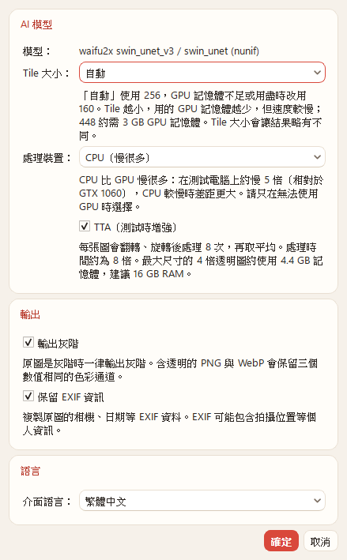
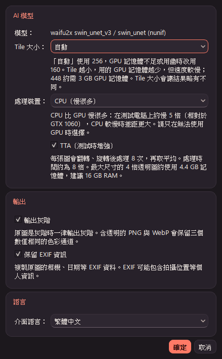
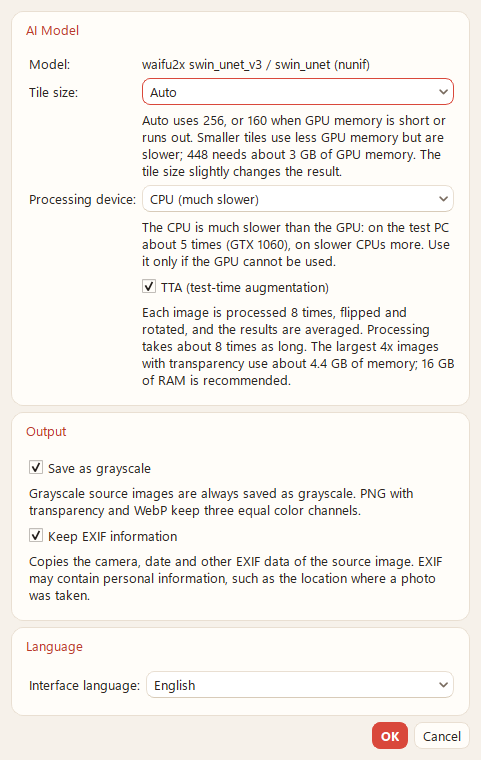
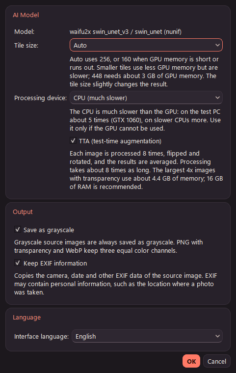
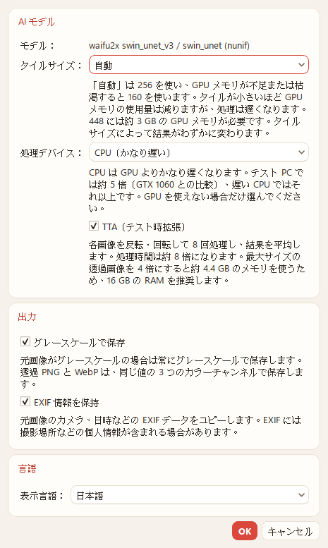
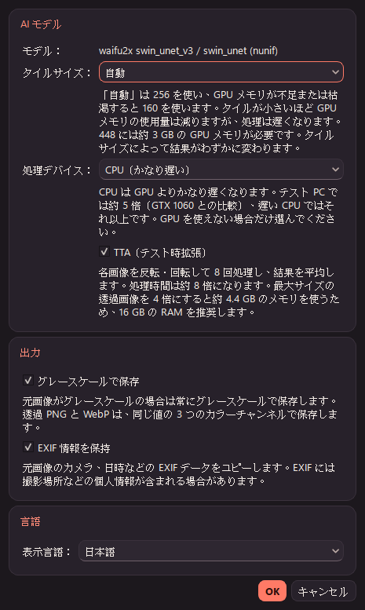

# AnimeRestoreX v2.1 — P3（灰階、ICC、EXIF）報告

- 日期：2026-11-14
- 分支：`main`（未推送、未打 tag、未封裝；版本號維持 2.0.1）
- 依據：`docs/v2.0-交接.md`、`docs/v2.1-P0-P1報告.md`、`docs/v2.1-P2報告.md`
- 環境：Windows 11 25H2、GTX 1060 6GB、MSVC 14.52.37025、`-std:c++23`、Qt 6.12.0、ORT 1.24.4 + DirectML 1.15.4；模型與 manifest 都未變動
- 上游：nunif `0d3d92c`（本機 `tools/winml-probe/_work/upstream/nunif`）；Pillow 13.0.0（`_work/venv-torch`，原始碼取自 PyPI sdist）

## 1. 結論

| 項目 | 結果 |
|---|---|
| P2 遺留：75 M 像素 4× 透明圖 + TTA | 峰值 private **4,185 MiB（4.4 GB）**，超過 4 GB。README、`packaging/README.txt` 與設定頁的 TTA 說明都加上「建議 16 GB RAM」（§2） |
| 新選項全關 | 16 個基準案例對 P2（`7f3c8de`）最大差 0，檔案逐位元組相同（§7.1） |
| 灰階 | 自動（來源是灰階）與「輸出灰階」選項（預設關閉）。像素公式與 Pillow `convert("L")` 完全相同：2^24 種 RGB 全部比對過，實際輸出 7 組對 Pillow 參考輸出最大差 0（§3） |
| ICC | 固定行為：可保留的 ICC 原樣寫回，像素不做色彩轉換。PNG／JPEG／WebP 寫回的位元組與原檔相同（§4） |
| EXIF | 「保留 EXIF」選項（預設關閉，註明可能含拍攝位置）。三種格式都支援讀寫，WebP 也支援（§5） |
| 與使用者摘要不同之處 | 依原始碼處理：調色盤 PNG 不算灰階、灰階 + alpha 的 PNG 算灰階；Qt 只對 JPEG 套用 EXIF 旋轉，PNG／WebP 的 Orientation 保持原值（§3.1、§5.2） |
| ctest | release 5／5（每個 commit），debug 5／5 |

## 2. P2 遺留：最大尺寸 4× 透明圖的記憶體

- **輸入**：`06_chibi_transparent` 用 Lanczos 放大到 2634×1708（4,498,872 像素，未超過 4.5 MP 的輸入上限），RGBA。
- **輸出**：10536×6832 = 71.98 M 像素。輸入上限 4.5 MP × 16 = 72 MP，所以 4× 實際到不了 75 MP，這已經是最大的情況。
- **工具**：P2 狀態（`7f3c8de`）的 `arx_verify`，GPU、tile 256、v3 不適用（4× 用舊 swin_unet noise1_scale4x + alpha scale4x）。結果在 `_work/v21p3/mem/`。

| 模式 | 時間 | 峰值 private | 結束時 private |
|---|---|---|---|
| TTA 關閉 | 70.4 s | 3,358.7 MiB（3.5 GB） | 1,820.0 MiB |
| TTA 開啟 | 253.3 s | **4,185.2 MiB（4.4 GB）** | 1,821.2 MiB |

- 差額 826.5 MiB，P2 報告 §5.1 的估算是 71.98 M × 12 B = 823.7 MiB，兩者相符。
- 交接檔記錄的「4× 透明約 2.1 GB」是較小的圖（2664×1728 輸出）的值；最大尺寸時不開 TTA 也要 3.4 GiB。README 的 8 GB 建議沒有改，另加一列「TTA：建議 16 GB」。
- 設定頁的 TTA 說明加上「最大尺寸的 4 倍透明圖約使用 4.4 GB 記憶體，建議 16 GB RAM」。

## 3. 灰階

### 3.1 上游行為（nunif 0d3d92c）

| 行為 | 出處 |
|---|---|
| 載入時記錄 `meta["grayscale"] = im.mode in {"L", "LA", "I", "I;16"}` | `nunif/utils/pil_io.py:88` |
| L 帶 tRNS 時先轉 LA；P 帶 tRNS 時轉 RGBA | `pil_io.py:51-57` |
| 不是 RGB／RGBA／L／LA 的模式（包括 P、1）一律 `convert("RGB")` | `pil_io.py:80-85` |
| waifu2x 用 `color="rgb", keep_alpha=True` 載入，L → RGB、LA → RGBA 後再送進模型 | `waifu2x/ui_utils.py:88`、`pil_io.py:105-110` |
| 存檔時 `meta["grayscale"]` 為真：RGB → `convert("L")`，RGBA → `convert("LA")` | `pil_io.py:292-296` |
| `--grayscale` 強制 `meta["grayscale"] = True` | `waifu2x/ui_utils.py:76-77`、`274` |
| JPEG 存檔時 LA／RGBA 用 `remove_alpha` 合成到白底（在轉灰階之後） | `pil_io.py:321-324`、`31-35` |

**與摘要不同、依原始碼處理的地方**：

| 情況 | Qt 讀到的格式 | Pillow 模式 | nunif | 本程式 |
|---|---|---|---|---|
| 8 位元灰階 PNG／JPEG | Grayscale8 | L | 灰階 | 灰階 |
| 2／4 位元灰階 PNG | Indexed8（灰色調色盤） | L | 灰階 | 灰階 |
| 灰階 PNG + tRNS | Indexed8（灰色調色盤） | L → LA | 灰階 | 灰階 |
| 灰階 + alpha PNG（color type 4） | ARGB32 | LA | 灰階 | 灰階 |
| 調色盤 PNG，調色盤只有灰色 | Indexed8（灰色調色盤） | P | **RGB** | **RGB** |
| 1 位元灰階 PNG | Mono | 1 | **RGB** | **RGB** |
| 16 位元灰階 | Grayscale16 | I;16 | 灰階 | 拒絕（本來就不支援 16 位元） |

- 摘要寫「Grayscale8／16，或調色盤只有灰色的 Indexed8」。但 Qt 的格式分不出上表的三種 Indexed8，也看不出灰階 + alpha。所以改成直接讀檔頭：PNG 看 IHDR 的 color type 為 0 或 4、bit depth ≥ 2；JPEG 看 SOF 的元件數為 1；WebP 一律不是灰階。
- 判斷在 `ImageLoader` 的 RGB 轉換之前完成：讀檔頭的 `metadata::read` 在 `reader.read()` 之前呼叫。結果存在 `LoadResult::meta.grayscale`。
- 實測（`_work/v21p3/run1/png`）：`gray_l`、`gray_2bit`、`gray_icc`、`gray_la`、`gray_trns` 是灰階；`gray_palette`、`gray_1bit`、`rgb_gray_pixels` 不是。

### 3.2 公式（Pillow 13.0.0）

- `src/libImaging/Convert.c:39`：`#define L24(rgb) ((rgb)[0] * 19595 + (rgb)[1] * 38470 + (rgb)[2] * 7471 + 0x8000)`。
- `rgb2l`（`Convert.c:209-215`）與 `rgba2la`（`396-403`）都是 `L24(in) >> 16`；`rgba2la` 的 alpha 原樣複製。轉換表 `Convert.c:1473`（RGB→L）、`1494-1495`（RGBA→L、RGBA→LA）。
- 實作：`ImageEncoder::luma`／`toGrayscale`，用整數運算，與上式相同。沒有用 `qGray` 或 `QImage::convertToFormat`：
  - `qGray` 是 (11R+16G+5B)/32。
  - Qt 6.12 對帶色彩空間的圖轉 Grayscale8 會先線性化（實測 P3 圖的 (107,161,128) 得到 148，Pillow 是 141）。
- **驗證**：
  - 用 numpy 對全部 2^24 種 RGB 跑一次，與 Pillow 實際的 `convert("L")` 比對，0 個不同。
  - `tst_core::grayscaleMatchesPillow` 固定 10 組 Pillow 的參考值，並檢查 RGBA 的 alpha 不變。

### 3.3 輸出

| 輸出 | 灰階時的檔案 | 說明 |
|---|---|---|
| PNG 不透明 | Grayscale8（color type 0） | 與 Pillow L 相同 |
| PNG 透明 | RGBA，R=G=B | **與 nunif 的 LA 不同**：Qt 沒有 8 位元「灰階 + alpha」格式。像素值與 LA 相同，只是存成三個通道 |
| JPEG | 單通道（SOF 元件數 1） | 透明圖照現有流程：先把 R=G=B 的 RGBA 合成到白底（`QPainter`），再取一個通道。順序與 nunif 相同（先灰階、後去 alpha），但合成的捨入用的是 Qt 的，不是 Pillow 的 `paste` |
| WebP | RGB(A)，R=G=B | WebP 沒有灰階模式 |

- 模型輸出（含 TTA 合併）量化成 8 位元之後才轉灰階，與 nunif 相同。P4 的顆粒會在這之前套用。
- **驗證**（`_work/v21p3/verify_p3.py` 第 1 段）：同一個模型輸入，RGB 版輸出用 Pillow `convert("L")`／`convert("LA")` 當參考，和本程式的灰階輸出比對。7 組（5 張灰階來源、強制灰階的 P3 RGB 與 RGBA）全部最大差 0，模式正確。

## 4. ICC

### 4.1 改動前的行為（實測）

用 Pillow 產生帶 Display P3 描述檔（560 bytes，自建 v4 矩陣描述檔）的圖，`_work/v21p3/qtprobe` 實測 Qt 6.12.0，`before/` 是 P2 的 `arx_verify` 輸出：

| 項目 | PNG | JPEG | WebP |
|---|---|---|---|
| `QImageReader` 讀入後的 `colorSpace()` | 有（P3，`iccProfile()` 與原檔相同） | 有 | 有 |
| `convertToFormat`（RGB888／ARGB32／RGBA8888／RGB32）之後 | 保留，像素不變 | 保留，像素不變 | 保留，像素不變 |
| `convertToFormat(Grayscale8)` | 保留 RGB 色彩空間，並做色彩轉換 | 同左 | 同左 |
| QImage 帶 P3 色彩空間時，Qt 寫檔 | 寫 iCCP（位元組與原檔相同） | 寫 APP2（相同） | 寫 VP8X + ICCP（相同） |
| QImage 是 Grayscale8 + 灰階色彩空間時，Qt 寫檔 | 寫 iCCP | **不寫** | 寫 ICCP |
| **P2 的 ImageLoader** | 非 sRGB 先轉成 sRGB，再清掉色彩空間 | 同左 | 同左 |
| **P2 的輸出檔** | 沒有 ICC | 沒有 ICC | 沒有 ICC |

改動前，P3 圖的像素會先轉成 sRGB 再送進模型；同一張測試圖新舊輸出最大差 118。

### 4.2 新做法

- **像素不做色彩轉換**：直接在原本的色彩空間處理，輸出時把原本的 ICC 原樣寫回。
- **與 nunif 不同**：nunif 載入時用 `ImageCms.profileToProfile` 轉成 sRGB（`pil_io.py:58-78`），存檔時再轉回原描述檔（`pil_io.py:266-290`）。這等於多做兩次 8 位元的色彩轉換，會有捨入損失，模型輸入也不同。本程式的模型輸入就是檔案裡的值。
- **寫入方式**：不靠 Qt 寫入器，由 `metadata::embed` 自己寫：
  - Qt 寫 Grayscale8 的 JPEG 時不寫 ICC。
  - 不支援的描述檔 Qt 解析不了。
  - EXIF 本來就要自己寫。
  - 工作用的 QImage 一律不帶色彩空間，所以 Qt 不會改像素，也不會另外寫 ICC。
- **規則**：

| 來源描述檔 | 輸出 | 寫入 |
|---|---|---|
| RGB | RGB(A) | 原樣寫回 |
| RGB | 灰階（自動或強制） | 不寫（diagnostics：`dropped: RGB profile on grayscale output`） |
| GRAY（灰階來源） | 單通道灰階（PNG／JPEG 不透明） | 原樣寫回 |
| GRAY（灰階來源） | RGBA PNG、WebP | 不寫：GRAY 描述檔不能描述 RGB 資料（PNG 規格不允許，WebP 也只用於 RGB） |
| CMYK、Lab 等，或 GRAY 但來源不是灰階 | — | 不寫，並照舊處理：Qt 認得的非 sRGB 色彩空間轉成 sRGB |
| 沒有 ICC（含 PNG 只有 gAMA／cHRM／sRGB chunk） | — | 不寫，維持現狀（gAMA／cHRM 若不是 sRGB 仍轉成 sRGB） |

- 這項沒有開關，是固定行為。沒有 ICC 的輸入，輸出與 P2 逐位元相同（§7.1）。
- **讀取來源**：PNG iCCP（zlib 解壓）、JPEG APP2 `ICC_PROFILE`（依序號組合多段）、WebP ICCP。
- **寫入位置**：PNG 放在 IHDR 之後；JPEG 放在 APP0 之後，超過 65,519 bytes 時分段；WebP 放在 VP8X 之後。
- **遺留差異**：nunif 會寫回 PNG 的 gAMA chunk（`pil_io.py:89-96`、`300-301`），本程式沒有做；P3 只處理 ICC。

### 4.3 驗證

- **Pillow 讀回**（`verify_p3.py` 第 2 段）：
  - PNG／JPEG／WebP 無損 × 7 張（P3 RGB、P3 RGBA、灰階 ICC、P3 + EXIF、P3 + EXIF + alpha、兩張沒有 ICC 的圖）全部符合上表。
  - `icc_profile` 與原描述檔逐位元組相同。
  - 強制灰階時，RGB 描述檔確實沒有寫入。
- **單元測試**：
  - `tst_core::metadataEmbedRoundTrip`：4 種編碼（PNG、JPEG、WebP 有損、WebP 無損）× 是否透明 × 3 種描述檔（P3、150 KB 的大描述檔、無）× 是否有 EXIF。用 `metadata::read` 讀回後 ICC／EXIF 完全相同；解碼後像素與不加中繼資料的檔案相同；Qt 讀回的色彩空間是 P3。150 KB 那組會讓 JPEG 分成 3 段 APP2。
  - `tst_core::loaderKeepsIccAndDetectsGray`：Qt 寫的 P3 PNG／JPEG／WebP 載入後，`meta.icc` 與描述檔相同，像素等於不轉換的解碼值。灰階描述檔在灰階來源上保留。
  - `tst_pipeline::iccAndExifThroughTheJob`：經過 ProcessJob 後，輸出帶同一份描述檔。
- **Windows**：WIC（`System.Windows.Media.Imaging.BitmapDecoder`）解碼 PNG／JPEG／WebP 輸出，都有 1 個 ColorContext。

## 5. EXIF

### 5.1 讀取與修改

- **讀取**：JPEG 第一個 APP1 `Exif\0\0`、PNG eXIf、WebP EXIF。PNG 與 WebP 若誤以 `Exif\0\0` 開頭會先去掉。只解析 TIFF 結構，沒有用 exiv2 等函式庫。
- **結構檢查**（`metadata::prepareExif`）：
  - 要有 `II*\0` 或 `MM\0*` 開頭。
  - IFD0、Exif IFD、GPS IFD、Interoperability IFD 的表格與每個超出 4 bytes 的值都要落在區塊內。
  - 項目數 ≤ 4096。
  - 子 IFD 不可指回已讀過的 IFD。
  - 未知型別的值不檢查。
  - 任何一項不符就不寫 EXIF，圖照常輸出，diagnostics 記錄原因（例：`exif: not written: IFD0 offset 16777200 is outside the EXIF block`）。
- **修改**（其他欄位逐位元組保留）：
  - **Orientation**：載入時有轉正就改成 1。
  - **PixelXDimension／PixelYDimension**：有的話改成輸出尺寸。值超過 65535 而原型別是 SHORT 時，改成 LONG（值仍放得進項目本身）。
  - **縮圖（IFD1）**：IFD0 的 next 指標改成 0；IFD1 的表格、值與縮圖資料清成 0。如果這些都在其他資料之後，就直接截掉。如果和保留的資料重疊（損壞的檔案），只解除連結，不清除。實測 IFD1 與縮圖共 742 bytes 被截掉，EXIF 由 1060 bytes 變成 318 bytes。

### 5.2 Orientation：Qt 只轉正 JPEG

| 來源 | `QImageReader::transformation()`（autoTransform 開啟） | 像素 | 輸出的 Orientation |
|---|---|---|---|
| JPEG，Orientation 6 | Rotate90 | 已轉正（96×64 → 64×96） | 1 |
| PNG eXIf，Orientation 6 | None | **未轉正** | 6（照原值） |
| WebP EXIF，Orientation 6 | None | **未轉正** | 6（照原值） |

- 摘要寫「Orientation 改成 1（載入時已經轉正了）」，但實測 Qt 6.12 只會轉正 JPEG。PNG／WebP 的像素沒有轉，如果改成 1，看圖軟體就不會再旋轉，畫面反而錯了。所以只有在 Qt 真的轉正時才改成 1，其他照原值。diagnostics 會寫出是哪一種（`orientation reset to 1`／`orientation as in source`）。
- **與 nunif 的差異（未修改，請你決定）**：nunif 預設對所有格式做 `ImageOps.exif_transpose`（`ui_utils.py:88`、`pil_io.py:46-47`），所以 PNG／WebP 帶旋轉的圖，nunif 的輸出是轉正的，本程式不是。這在 P3 之前就存在，與 EXIF 選項無關。如果要一致，要在 ImageLoader 自己套用 PNG／WebP 的 Orientation，而且預覽與清單縮圖也要跟著改，所以這次沒有做。

### 5.3 寫入

| 格式 | 位置 | 說明 |
|---|---|---|
| JPEG | SOI 之後的 APP1（`Exif\0\0` + TIFF） | 在 Qt 寫的 APP0（JFIF）之前，依 Exif 規格放在 SOI 正後方。上限 65,527 bytes，超過就不寫並記錄 |
| PNG | eXIf，放在 IHDR（與 iCCP）之後、IDAT 之前 | |
| WebP | 改成擴充格式：VP8X、ICCP、(ALPH)、VP8／VP8L、EXIF | 照 WebP 容器規格的順序 |

- **WebP**：
  - Qt 輸出簡易格式（VP8 或 VP8L）時，由位元流標頭取得畫布尺寸。VP8L 也取 alpha 位元，用來設定 VP8X 的 alpha 旗標。
  - Qt 已輸出 VP8X（有損 + alpha：VP8X + ALPH + VP8）時，只加旗標。ICC 旗標是 0x20、EXIF 是 0x08。
  - 加入後更新 RIFF 大小，奇數長度的 chunk 補 1 byte。
  - 實測四種組合（有損／無損 × 有無 alpha）加上有 ICC 的情況，Pillow（libwebp）與 WIC 都能正確解碼，所以 **WebP 有支援**，不需要在 UI 註明例外。
- **暫存與提交**：
  - 沿用現有流程：寫進 `.tmp`，完成後改名，不覆寫。
  - 有中繼資料時，先編碼到記憶體，插入後一次寫進 `.tmp`。所以多一份編碼後檔案大小的記憶體；這時 float 緩衝區已經釋放，不影響 §2 的峰值。
  - 沒有中繼資料時走原本的路徑。

### 5.4 驗證

**Pillow 讀回**（`verify_p3.py` 第 3 段，PNG／JPEG／WebP 無損各 9 張，WebP 有損另外以 Pillow 讀回）：

| 案例 | 結果 |
|---|---|
| 帶旋轉的 JPEG（Orientation 6，有縮圖） | 輸出 128×192；Orientation 1；Pixel 128×192；IFD1 已移除；Make／Model／Software／DateTimeOriginal 不變 |
| 帶 GPS 的 JPEG | GPS 5 個欄位與原檔相同；Orientation 1；IFD1 已移除 |
| PNG（eXIf，Orientation 6，LONG 尺寸） | Orientation 6（Qt 未轉正）；Pixel 192×128；GPS 相同 |
| WebP（EXIF；另有 ICC + EXIF、alpha + EXIF） | 同上；VP8X 旗標與 chunk 順序正確 |
| EXIF 損壞的 JPEG（IFD0 位移超出範圍）、PNG（項目數 32767） | 照常輸出，沒有 EXIF，diagnostics 有原因 |

合計 0 個失敗。

**Windows 檔案總管**（Shell 屬性系統，也就是「內容 → 詳細資料」的值）：

| 輸出 | 方向 | 相機 | GPS 緯度 | 拍攝日期 |
|---|---|---|---|---|
| JPEG（原本帶旋轉） | 1 | ARXTestMake／ARX Model 1 | — | 2026/11/14 |
| JPEG（GPS + P3） | 1 | 有 | 25/2/30 | 有 |
| WebP 無損（GPS + P3）、WebP 有損（GPS + P3 + alpha） | 1 | 有 | 25/2/30 | 有 |
| PNG（eXIf） | 空白 | 空白 | 空白 | 空白 |
| 損壞 EXIF 的 JPEG | 空白（沒有 EXIF） | | | |

- **PNG 欄位空白的原因**：連 Pillow 直接寫出的來源檔（`meta-in/exif_rot6.png`）也一樣是空白，所以是 Windows 的屬性系統不讀 PNG eXIf，不是輸出的問題。
- **能否開啟**：所有輸出都能用 WIC 解碼（相片 App 用的就是 WIC）。相片 App 本身沒有開啟（未執行）。

**單元測試**：

- `tst_core::exifPrepare`：小端與大端；Orientation；SHORT 改 LONG；LONG 不變；IFD1 截掉後是 88 bytes。
- `tst_core::exifPrepareRejectsDamaged`：7 種損壞。
- `tst_pipeline::iccAndExifThroughTheJob`：選項關閉時沒有 EXIF；開啟時欄位正確；損壞時照常輸出；來源檔的 SHA-256 不變。

## 6. UI

| 語言 | 淺色 | 深色 |
|---|---|---|
| zh_TW |  |  |
| en |  |  |
| ja |  |  |

- **截圖方式**：tst_ui 的 `ARX_UI_SNAPSHOT`，`languageSwitchRetranslates`，windows platform。選了 CPU，勾選所有選項。
- **版面**：新增「輸出」群組，放兩個勾選框與說明。ICC 是固定行為，沒有控制項。
  - 原生 Qt 介面，只採用通用設計原則：預設關閉，說明寫出代價或風險（EXIF 的個人資訊）。
  - 三種語言都沒有截字；`tst_ui_layout` 的最小尺寸預算檢查通過。
- **程式結構**：`SettingsDialog` 與 `MainWindow::applySettings` 改為傳 `SettingsValues` 結構，P4 的顆粒也會放在裡面。
- **翻譯**：
  - zh_TW：「輸出」「輸出灰階」「原圖是灰階時一律輸出灰階。含透明的 PNG 與 WebP 會保留三個數值相同的色彩通道。」「保留 EXIF 資訊」「複製原圖的相機、日期等 EXIF 資料。EXIF 可能包含拍攝位置等個人資訊。」
  - ja：「出力」「グレースケールで保存」「EXIF 情報を保持」等。218 項全部完成。
  - zhtw-guard：只命中既有的一個用語（zh_TW.ts 第 737 行，P2 報告 §7 已記錄），本輪未改。
- **設定**：`v2/output/grayscale`、`v2/output/keepExif`，只有 `true` 才算開啟。舊設定檔沒有這兩個鍵時視為關閉，不需要遷移。JobSpec 在開始批次時取設定的快照（`currentSpec`），處理中改設定不影響正在跑的工作。

## 7. 驗證總表

### 7.1 新選項全關：16 個案例

- `_work/v21base/run-cases.sh`（15 張）與 2400×1606 計時圖，對 P2 的 `out-p2`／`time-p2off` 比對。
- 全部最大差 0、檔案逐位元組相同（`_work/v21p3/compare-p3-off.txt`）。
- 這些輸入都沒有 ICC、gAMA 或 EXIF，也不是灰階。

### 7.2 ctest

- release 5／5：C1–C4 每個 commit 都只建置該 commit 的內容（`git stash --keep-index`）並跑 ctest。
- debug 5／5。

**debug 抓到的測試錯誤**：

- **現象**：開發中曾有一次 release ctest 的 `tst_pipeline` SegFault，單獨重跑 15 次與完整 ctest 2 次都沒有重現；debug 建置則固定在 `std::expected::error()` 中斷。
- **原因**：測試寫成 `QVERIFY2(x.has_value(), qPrintable(x.error()))`，有值時也會呼叫 `error()`，是未定義行為。
- **修正**：兩處都改成只在沒有值時呼叫。產品程式碼沒有這種寫法。

### 7.3 實測資料

| 位置（`tools/winml-probe/_work/v21p3/`） | 內容 |
|---|---|
| `make_meta_inputs.py`、`meta-in/` | 測試圖（P3／灰階描述檔、灰階各種形式、EXIF 旋轉／GPS／損壞） |
| `qtprobe/` | Qt 行為實測程式與輸出 |
| `run1/`、`run2/`、`before/` | 新版各格式輸出、灰階參考、P2 版輸出 |
| `verify_p3.py`、`chunks.py` | Pillow 驗證與容器結構列出 |
| `mem/` | §2 的記憶體測試 |

## 8. commit

| commit | 內容 |
|---|---|
| `e373d2c` | core：`ImageMetadata`（讀 ICC／EXIF／灰階判定、`prepareExif`、`embed`），ImageEncoder 的灰階與中繼資料寫入；單元測試 |
| `f02b7d1` | core：保留 ICC、灰階（自動與強制）、AppSettings、arx_verify `:gray`；測試 |
| `26600c2` | core：保留 EXIF 選項、AppSettings、arx_verify `:exif`；測試 |
| `8f8e46d` | ui：設定的「輸出」群組、`SettingsValues`、TTA 記憶體說明、README、翻譯 |
| 本報告 | 報告、截圖、開發記錄 |

## 9. 未執行

- 相片 App 開啟輸出（以 WIC 解碼與檔案總管屬性代替）。
- 灰階透明圖輸出 JPEG 時，與 Pillow `remove_alpha` 的逐像素比對（合成用 Qt 的捨入，見 §3.3）。
- CMYK JPEG、Lab 描述檔等的實際檔案（依規則不寫入 ICC，沒有測試圖）。
- 大於 64 KB 的實際 EXIF（只有單元測試的長度檢查）。
- PNG／WebP 的 Orientation 轉正（§5.2，待你決定）。

## 10. 查過的文件

- **nunif 0d3d92c 原始碼**：`nunif/utils/pil_io.py`、`waifu2x/ui_utils.py`，行號見 §3.1、§4.2、§5.2。
- **Pillow 13.0.0 原始碼**（PyPI sdist）：`src/libImaging/Convert.c`，行號見 §3.2。
- **Context7（Qt 6，`/websites/doc_qt_io_qt-6`）**：
  - `QColorSpace::iccProfile`、`fromIccProfile`、`colorModel`。文件寫明從 ICC 建立時會回傳原本的描述檔，與實測相符。
  - `QImageReader::transformation`、`setAutoTransform`。文件沒有說明哪些格式會套用 EXIF 旋轉，也沒有說明寫入器是否寫入色彩空間，所以用 `qtprobe` 實測（§4.1、§5.2）。
- **規格**：WebP 容器（VP8X 旗標與 chunk 順序）、PNG eXIf／iCCP、Exif APP1／TIFF IFD 結構，依既有知識實作，以 Pillow、libwebp、WIC 讀回驗證。這次沒有連網查詢。
