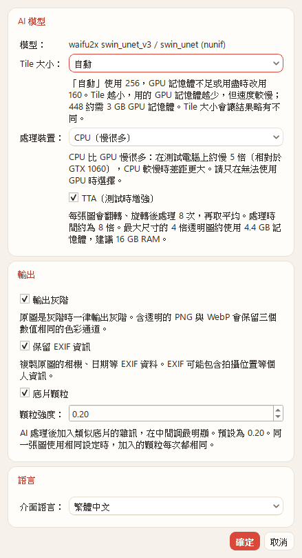
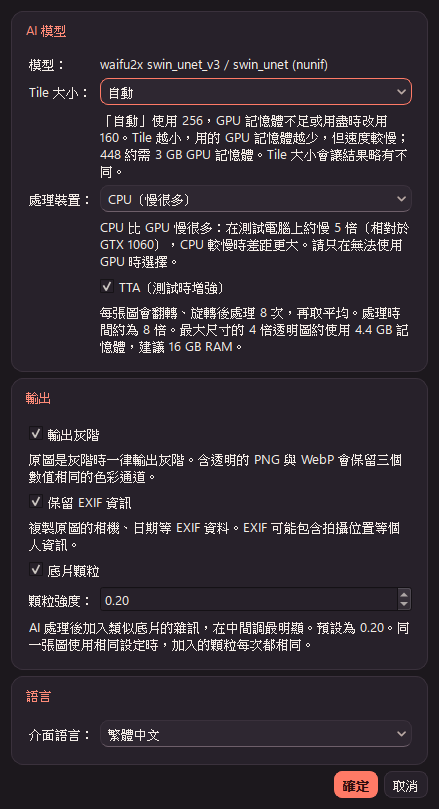
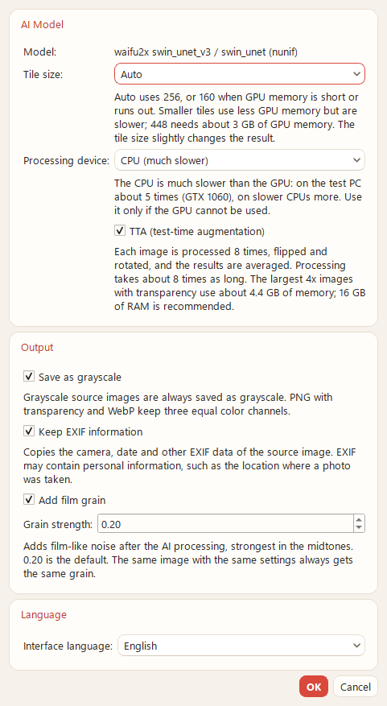
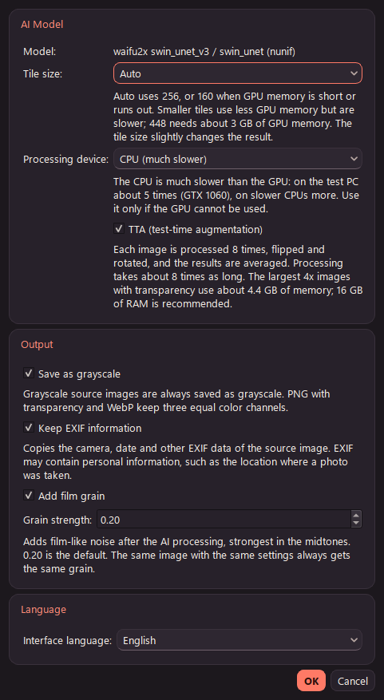
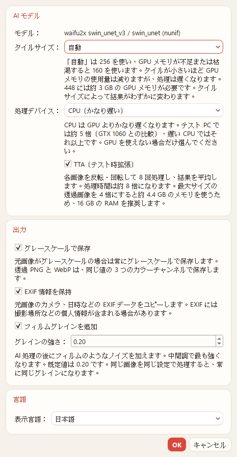
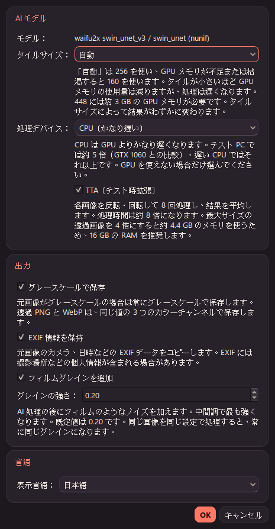

# AnimeRestoreX v2.1 — P4（底片顆粒）報告

- 日期：2026-11-14
- 分支：`main`（未推送、未打 tag、未封裝；版本號維持 2.0.1）
- 依據：`docs/v2.0-交接.md`、`docs/v2.1-P2報告.md`、`docs/v2.1-P3報告.md`
- 環境：Windows 11 25H2、GTX 1060 6GB、MSVC 14.52.37025、`-std:c++23`、Qt 6.12.0、ORT 1.24.4 + DirectML 1.15.4；模型與 manifest 都未變動
- 上游：nunif `0d3d92c`（本機 `tools/winml-probe/_work/upstream/nunif`）

## 1. 結論

| 項目 | 結果 |
|---|---|
| 實作 | 照 nunif 0d3d92c 的 `rgb_noise_like(level=2)` 與 `apply_rgb_noise`，在模型輸出（含 TTA 合併）之後、quantize256 之前以 float32 套用；只處理 RGB，alpha 不動；灰階是在之後才轉換 |
| 與上游不同 | 上游沒有設定種子。這裡用固定種子（由輸出尺寸和強度算出），並使用自己的亂數產生器（SplitMix64 → Box–Muller），不使用 `std::normal_distribution`（§3） |
| 1. 套用函式 對 Python | 固定的雜訊值，與 numpy 版上游公式比對：13,056 個值 **0 個不同（最大差 0）**；numpy 版對 nunif 原本的 torch 函式也是 8 位元最大差 0（§5.1） |
| 2. 同一張圖跑兩次 | GPU 實機兩張圖 × 兩種強度，以及 2400×1606 計時圖，檔案逐位元組相同（§5.2） |
| 3. 顆粒關閉 | 16 個案例對 P3 完成後（`09d6152`）最大差 0，檔案逐位元組相同（§5.3） |
| 4. 肉眼確認 | 預設 0.20 與最大 1.00 的輸出和裁切比較放在 §6 |
| 5. ctest | release 5／5（每個 commit），debug 5／5 |
| 時間 | 2400×1606 2× t256：關閉 19.3–19.7 s，開啟 23.6–23.9 s（+4.2 s；平行化之前 +8 s）（§7） |
| UI | 「輸出」群組加入「底片顆粒」與強度 0.05–1.00（預設 0.20）；完成清單標示「（底片顆粒）」；diagnostics 記錄強度與種子 |

## 2. 上游行為（nunif 0d3d92c）

| 行為 | 出處 |
|---|---|
| 雜訊：`noise = torch.randn_like(base)`，每個通道各自獨立的 N(0,1) | `nunif/utils/rgb_noise.py:7` |
| level 2：`noise2 = torch.randn(H // 2, W // 2)`（每個通道），`F.interpolate(size=(H, W), mode="nearest")` 放大，`noise.mul_(0.5).add_(noise2, alpha=0.5)` | `rgb_noise.py:8-18` |
| `rgb_noise_like(base, level=2)` 的預設是 level 2；`process_image` 呼叫時沒有指定，所以用 **level 2** | `rgb_noise.py:5`、`waifu2x/ui_utils.py:67` |
| 套用：`output = rgb ** gamma`；`correlated_noise = noise * output`；`light_decay = ((1 - output) * light_decay_strength + (1 - light_decay_strength)) ** gamma`；`output = (output + correlated_noise * light_decay * strength).clamp(0, 1) ** (1 / gamma)` | `rgb_noise.py:23-37` |
| 預設值：`strength=0.2`、`gamma=2.2`、`light_decay=True`、`light_decay_strength=0.8`。`process_image` 只傳 `strength`，其他都用預設值 | `rgb_noise.py:23`、`ui_utils.py:69` |
| 靜態圖：`strength = args.grain_strength * 0.5`（註解「grain_strength = 1/2 for image」） | `ui_utils.py:66-69` |
| 順序：`ctx.convert`（tiled render、TTA 合併、clamp）→ 顆粒 → `IL.to_image`（quantize256）→ 存檔時才轉灰階 | `ui_utils.py:55-79`、`pil_io.py:254`、`pil_io.py:292-296` |
| 只處理 RGB；alpha 由 `convert` 另外回傳，`to_image` 時才放回 | `ui_utils.py:55-79` |
| 沒有設定亂數種子 | `rgb_noise.py:7`、`9`（`torch.randn` 沒有 generator） |

**你的摘要對照**：

- 公式：摘要寫 `(1 − 0.8·L)^2.2`。原始碼是 `((1 − L)·0.8 + 0.2)^2.2`，展開後就是 `1 − 0.8·L`，兩者相同。
- 強度預設值：
  - 程式碼：CLI 參數 `--grain-strength` 的預設是 **0.2**（`ui_utils.py:365`）。
  - GUI：下拉選項 0.5／0.4／0.3／0.2／0.1，預設選第 4 項 **0.2**（`waifu2x/gui.py:270-274`）；輸入檢查允許 0.0–1.0（`gui.py:577-580`）；0 視為關閉（`gui.py:646`）。
  - 文件：`waifu2x/docs/cli.md:48-50` 寫「(video only) (default: 0.05)」，與程式碼不符：預設不是 0.05，而且程式碼對靜態圖也會套用（`ui_utils.py:66`）。
  - **以程式碼為準：0.2**。靜態圖實際套用 0.1。
- 影片路徑（`ui_utils.py:181-189`）用 `grain_strength` 本身（不乘 0.5）並在影格間混合雜訊，本程式只處理靜態圖，不適用。

## 3. 與上游不同的地方：固定種子與自己的亂數

### 3.1 雜訊場

- **上游**：`torch.randn` 沒有種子，每次執行的顆粒都不同。
- **這裡**：雜訊值是（種子、串流、索引）的純函式，同一張圖、同樣設定，每次輸出都完全相同。
  1. 種子：`grainSeed(輸出寬, 輸出高, 套用強度)`，以 SplitMix64 依序混入版本標記 `"ARXGRAIN"`、寬、高、強度的 float 位元。
  2. 每個值：`base = splitMix(seed ^ splitMix(stream + 1))`；`a = splitMix(base + 2·index)`、`b = splitMix(base + 2·index + 1)`；取高 53 位元得到 u1 ∈ (0, 1]、u2 ∈ [0, 1)；Box–Muller 的 cos 分支 `sqrt(−2 ln u1) · cos(2π u2)`，以 double 計算後轉成 float（torch 的 randn 也是 float32）。
  3. level 2：串流 0 是全解析度 `(c·H + y)·W + x`；串流 1 是半解析度 `(c·⌊H/2⌋ + y')·⌊W/2⌋ + x'`，(y', x') 用 ATen `nearest_idx` 的規則（等大回傳 dst，兩倍用 `dst >> 1`，其他 `min(floorf(dst · (float)in/out), in − 1)`）。最後 `n1 * 0.5f + 0.5f * n2`，與 `noise.mul_(0.5).add_(noise2, alpha=0.5)` 同樣的運算順序。
- **不存雜訊場**：每個像素需要時才計算，所以 75 MP 時也不需要多 900 MB 的記憶體。
- **1 像素邊**：上游 `torch.randn(H // 2, …)` 在 H = 1 時會是 0 列，`F.interpolate` 會失敗；這裡半解析度至少 1 列／欄。
- **不用 `std::normal_distribution`**：各家標準函式庫的演算法不同。Box–Muller 用到 `std::log`、`std::cos`、`std::sqrt`，`sqrt` 是 IEEE 精確捨入；`log`、`cos` 在同一份 MSVC CRT 下結果固定，但不同平台的數學函式庫可能有最後一位的差異。這只影響「換平台」，不影響「同一台電腦重跑」。
- **統計**：100 萬個樣本平均 0.00013、變異數 0.998（`tst_inference_core`）。

### 3.2 套用

`applyGrain(v, n, s)` 全程 float32，運算順序照 `rgb_noise.py:26-36`：

```
out   = powf(v, 2.2f)
corr  = n * out
decay = powf((1 - out) * 0.8f + (float)(1 - 0.8), 2.2f)
out   = out + corr * (decay * s)
return powf(clamp(out, 0, 1), (float)(1 / 2.2))
```

### 3.3 位置與順序

| 路徑 | 套用位置 |
|---|---|
| 一般 | `tiledRender` 的 RGB 輸出：`clamp(sum / weight, 0, 1)` 之後、quantize256 之前 |
| TTA | `writeTtaMean`：`× 1/8`、clamp 之後、quantize256 之前（即 TTA 合併後） |
| alpha | 不經過顆粒（alpha 走另一個 sink） |
| 灰階 | 8 位元結果完成後才轉 L（P3），所以是「先加顆粒、再轉灰階」，與 nunif 相同 |
| GPU 復原 | 顆粒在最後一步，用 160 重做時同樣套用；種子只與輸出尺寸和強度有關，與 tile 無關 |

- **平行化**：顆粒計算按列用 `std::execution::par` 平行。每個值只和種子與位置有關，與分割方式無關；實測平行與序列的輸出逐位元組相同（§5.2）。
- **關閉時**：迴圈是 P3 的原始程式碼，沒有任何額外分支。

## 4. 強度的對應

| 項目 | 值 |
|---|---|
| UI 控制項 | 「底片顆粒」勾選框（預設關閉）＋「顆粒強度」0.05–1.00，間隔 0.05，預設 0.20 |
| UI 數值的意義 | 就是 nunif 的 `grain_strength`（CLI `--grain-strength`、GUI「Add Noise」的值） |
| 實際傳給 `apply_rgb_noise` | `grain_strength × 0.5`，與 `ui_utils.py:69` 相同：預設 0.10，最大 0.50 |
| 範圍理由 | 上游 GUI 允許 0.0–1.0，0 視為關閉，所以下限取 0.05（0.05 的一步），上限 1.0。GUI 的選項 0.1–0.5 都包含在內 |
| 設定檔 | `v2/output/grain`（只有 `true` 才開啟）、`v2/output/grainStrength`（超出 0.05–1.0 或不是數字時用 0.2）。舊設定檔沒有這兩個鍵時就是關閉、0.2，不需要遷移 |
| 工作 | `InferenceOptions::grain`／`grainStrength`，屬於 JobSpec 快照；`checkOptions` 再檢查一次範圍 |

## 5. 驗證

### 5.1 套用函式對 Python（要求：最大差 1）

- **參考資料**：`tests/data/make_grain_reference.py` 用 numpy float32 照上游公式寫成，輸出 `tests/data/grain_reference.txt`。
  - 輸入：v = k/255（k = 0..255）× 雜訊 (j − 8)/4（j = 0..16，即 −2..2）× 強度 0.025／0.1／0.5（UI 的 0.05／0.20／1.00），共 13,056 個值。
- **numpy 參考對上游 torch**：`_work/v21p4/check_numpy_vs_torch.py` 直接 import nunif 0d3d92c 的 `apply_rgb_noise`（torch 2.14.1）。float 最大差 1.2e-7，8 位元最大差 0。
- **C++ 對參考**：`tst_inference_core::testGrainMatchesUpstream`，**0 個不同，最大差 0**。另外檢查雜訊 0 時 256 個值都不變。
- **經過 `upscaleImage`**：`testGrainThroughUpscale` 用最近鄰假引擎，期望值為 `quantize256(applyGrain(輸入值, field.at(c, y, x), s))`。
  - RGB 與 RGBA（略過 alpha = 0 的像素，那些 RGB 已被 alpha border padding 改寫）最大差 0。
  - alpha 與不加顆粒時完全相同；TTA 對一般路徑最大差 ≤ 1；同設定跑兩次相同；`grainSeed` 正確；強度 1.5 在任何 Run 之前就被拒絕。

### 5.2 同一張圖跑兩次（GPU 實機）

`arx_verify`，2× noise1 t256，`06_chibi_transparent`（RGBA）與 `01_sakura_portrait`：

| 案例 | 結果 |
|---|---|
| 強度 0.20，第 1 次對第 2 次 | 兩張都逐位元組相同（SHA-256 `5d8b7cc8…`、`f88753bf…`） |
| 平行化後再跑（0.20 與 1.00） | 與平行化前的檔案逐位元組相同 |
| 2400×1606 2×，平行化後跑 3 次 | 3 次相同，也與平行化前相同 |
| `tst_pipeline::grainThroughTheJob` | 經 ProcessJob 兩次的檔案 SHA-256 相同；灰階輸出 = 顆粒 RGB 輸出的 Pillow L |

diagnostics 範例：`grain: on (strength 0.20, applied 0.100, seed 0x94a7dd993f748b9b)`。

### 5.3 顆粒關閉：16 個案例

- 以最終 commit（`210c73a`）重跑 `_work/v21base/run-cases.sh` 與計時圖，對 P3 的 `v21p3/out-p3`／`time-p3` 比對。
- 全部最大差 0、檔案逐位元組相同（`_work/v21p4/compare-off-final.txt`）。

### 5.4 其他格式

`_work/v21p4/grain-tta/`：TTA + 顆粒 + 強制灰階（PNG RGBA，R=G=B）、JPEG、WebP 有損都成功輸出，diagnostics 的種子相同（同尺寸、同強度）。

## 6. 肉眼確認

圖：`06_chibi_transparent` 2×（平塗的動漫圖，1332×864），合成到白底。

| 強度 | 完整輸出 | 與關閉時的差異 |
|---|---|---|
| 0.20（預設） |  | 平均 0.79，最大 12，81% 的像素有變化 |
| 1.00（最大） |  | 平均 4.07，最大 112 |

同一區域（520, 360）–（840, 600），左起：關閉／0.20／1.00。

- 100%：
- 200%（最近鄰放大）：

觀察：

- 預設強度在平塗區只是很細的彩色顆粒，100% 下幾乎看不出來。
- 最大強度在膚色、灰色等中間調明顯，線稿的黑色與白底幾乎不變，符合公式：亮度項 L 在暗部趨近 0，light decay 在亮部趨近 0.2^2.2。
- 每個通道的雜訊各自獨立，所以是彩色顆粒，與上游相同。

## 7. 時間

2400×1606 2×、tile 256，GPU（6 核心 CPU）：

| 版本 | 時間（s） |
|---|---|
| 顆粒關閉（P4 最終） | 19.3、19.4、19.7 |
| 顆粒開啟，序列（`7f0b770`） | 26.9、27.2、27.8、28.1 |
| 顆粒開啟，按列平行（`ab56c0b`） | 23.6、23.7、23.9 |

- 每個值要算 2 個常態亂數（log、sqrt、cos）與 3 次 powf，15.4 M 像素 × 3 通道。
- ETA：開啟顆粒時速度分組的 key 加上 `/grain`（與 `/tta` 相同的做法），量到第一張後就會用實測速度。

## 8. UI

| 語言 | 淺色 | 深色 |
|---|---|---|
| zh_TW |  |  |
| en |  |  |
| ja |  |  |

- **截圖方式**：tst_ui 的 `ARX_UI_SNAPSHOT`（windows platform）。選了 CPU，勾選所有選項，強度 0.20。
- **版面**：放在 P3 的「輸出」群組。勾選框下方是「顆粒強度」數值框，只有勾選時才能調整，下方是說明。
  - 原生 Qt 介面，只採用通用設計原則：預設關閉、寫出效果與「同設定同結果」。
  - 三種語言都沒有截字；`tst_ui_layout` 通過。
- **完成清單**：檔名後加上「（底片顆粒）」。完成對話方塊的摘要沒有加（與 TTA 相同，每一列已標示）。
- **翻譯**：
  - zh_TW：「底片顆粒」「顆粒強度：」「AI 處理後加入類似底片的雜訊，在中間調最明顯。預設為 0.20。同一張圖使用相同設定時，加入的顆粒每次都相同。」「（底片顆粒）」。
  - ja：「フィルムグレインを追加」「グレインの強さ：」等。222 項全部完成。
  - zhtw-guard：只命中既有的一個用語（P2、P3 已記錄），本輪未改。

## 9. commit

| commit | 內容 |
|---|---|
| `7f0b770` | inference：`upscaleImage` 的顆粒（雜訊場、套用、固定種子）；`tests/data` 參考資料與產生腳本；單元測試 |
| `11f46c1` | core：JobSpec、ProcessJob（套用 ×0.5、範圍檢查、diagnostics）、AppSettings、arx_verify `:grain[=S]`；測試 |
| `c44477f` | ui：設定的勾選框與強度、清單標示、翻譯 |
| `ab56c0b` | inference：按列平行（輸出與序列相同） |
| `210c73a` | core：ETA 的 `/grain` 速度分組 |
| 本報告 | 報告、截圖、開發記錄 |

- 每個 commit 都只建置該 commit 的內容並跑 ctest 5／5（release）；最終狀態另跑 debug 5／5。
- `7f0b770` 之後重建了 probe（`tile_runner`、`tile_runner_anytile` 的字串替換仍然有效）。

## 10. 未執行

- 對 nunif CLI `--grain` 的整張圖比對：上游沒有種子，雜訊不同，無法逐像素比較；只比對套用公式（§5.1）。
- 不同平台（非 MSVC CRT）上 `log`／`cos` 的最後一位差異：未測試。
- 75 M 像素開顆粒的時間與記憶體：顆粒不增加緩衝區；時間依 15.4 MP 的 +4.2 s 推估約 +20 s，未實測。
- CPU 推論搭配顆粒的計時。

## 11. 查過的文件

- **nunif 0d3d92c 原始碼**：`nunif/utils/rgb_noise.py`、`waifu2x/ui_utils.py`、`waifu2x/gui.py`、`waifu2x/docs/cli.md`、`nunif/utils/pil_io.py`，行號見 §2。
- **PyTorch**：`F.interpolate(mode="nearest")` 的來源索引規則（ATen `nearest_idx`）。依已知的實作寫成，再用 venv-torch 的 torch 2.14.1 實測輸出長度 5、7、8、9、1001、1733（輸入為一半），索引全部與本程式的規則相同。
- **Context7**：沒有查詢。用到的是 C++ 標準函式庫（`<execution>`、`<bit>`、`<cmath>`）與 P3 已用過的 Qt 元件（`QDoubleSpinBox`、`QCheckBox`、`QFormLayout`），依規則不另外查，以建置與測試為準。
