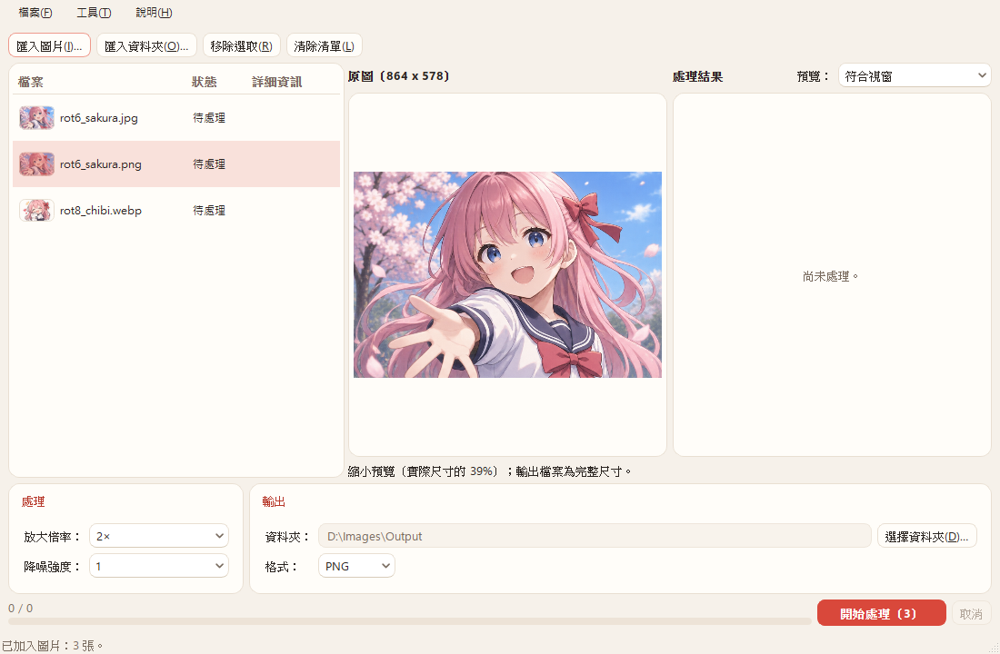

# AnimeRestoreX v2.1 — P5（PNG／WebP 的 EXIF 方向）報告

- 日期：2026-11-14
- 分支：`main`（未推送、未打 tag）
- 依據：`docs/v2.0-交接.md`、`docs/v2.1-P0-P1報告.md`、`docs/v2.1-P2報告.md`、`docs/v2.1-P3報告.md`、`docs/v2.1-P4報告.md`
- 環境：Windows 11 25H2、GTX 1060 6GB、MSVC 14.52.37025、`-std:c++23`、Qt 6.12.0、ORT 1.24.4 + DirectML 1.15.4；模型與 manifest 都未變動
- 上游：nunif `0d3d92c`；Pillow 13.0.0（`_work/venv-torch`）

## 1. 結論

| 項目 | 結果 |
|---|---|
| 做法 | PNG（eXIf）與 WebP（EXIF）載入時依 Orientation 轉正，對應方式與 Pillow `ImageOps.exif_transpose` 相同；JPEG 維持由 Qt 轉正。Orientation 用 P3 的 EXIF 解析器讀取（§2） |
| 輸出的 Orientation | 三種格式一律寫成 1，取代 P3 對 PNG／WebP「保留原值」的做法（§2.3） |
| 共用載入函式 | 工作（`ImageLoader`）、預覽、清單縮圖都改用 `OrientedReader`，三者方向一致（§2.2） |
| 1. 單元測試 | PNG、WebP 各 8 種 Orientation（PNG 偶數、WebP 奇數帶 alpha），轉正後的像素與 Pillow `exif_transpose` **完全相同**；預覽與縮圖用的讀取路徑也相同（§3.1） |
| 2. 實際 2× | Orientation 6 的 PNG、Orientation 8 的 WebP，「保留 EXIF」開與關、PNG 與 WebP 輸出：輸出與直立原圖的輸出**逐位元組相同**；開啟時 Orientation 為 1，其他欄位保留；關閉時沒有 EXIF。WIC 解碼尺寸是直立方向（§3.2） |
| 3. 預覽與清單縮圖 | 截圖確認 JPEG／PNG／WebP 都是直立（§3.3） |
| 4. 沒有 EXIF 的圖 | 16 個基準案例對 P4（`29ffa85`）最大差 0，檔案逐位元組相同（§3.4） |
| 5. ctest | release 5／5（每個 commit），debug 5／5 |

## 2. 實作

### 2.1 上游行為與對應

| 行為 | 出處 |
|---|---|
| waifu2x 預設 `exif_transpose=True`（`--disable-exif-transpose` 才關閉） | `waifu2x/ui_utils.py:88` |
| 載入時呼叫 `ImageOps.exif_transpose(im, in_place=True)`，不分格式 | `nunif/utils/pil_io.py:46-47` |
| 方向表：2 FLIP_LEFT_RIGHT、3 ROTATE_180、4 FLIP_TOP_BOTTOM、5 TRANSPOSE、6 ROTATE_270、7 TRANSVERSE、8 ROTATE_90；其他值不轉 | Pillow 13.0.0 `ImageOps.py:759-768` |

本程式的對應（`orientation::fromExif`）用 Qt 的 `QImageIOHandler::Transformations`，與 Qt 的 JPEG 處理器相同：先水平鏡像（Mirror）／垂直翻轉（Flip），再順時針轉 90°。

| Orientation | Pillow | Qt 轉換 | 輸出像素 |
|---|---|---|---|
| 2 | FLIP_LEFT_RIGHT | Mirror | `in(W−1−x, y)` |
| 3 | ROTATE_180 | Rotate180 | `in(W−1−x, H−1−y)` |
| 4 | FLIP_TOP_BOTTOM | Flip | `in(x, H−1−y)` |
| 5 | TRANSPOSE | FlipAndRotate90 | `in(y, x)` |
| 6 | ROTATE_270（順時針 90°） | Rotate90 | `in(y, H−1−x)` |
| 7 | TRANSVERSE | MirrorAndRotate90 | `in(W−1−y, H−1−x)` |
| 8 | ROTATE_90（逆時針 90°） | Rotate270 | `in(W−1−y, x)` |

- **轉換函式**：`QImage::flipped(Qt::Orientations)`（Qt 6.9 起）加上 `QImage::transformed(QTransform().rotate(90))`。後者在旋轉 90° 時只搬移像素、不重新取樣；用單元測試對 Pillow 逐像素確認（§3.1）。
- **調色盤與 1 位元圖**：轉換前先無損轉成 32 位元，避免 `transformed` 走一般的重新取樣路徑。
- **色彩空間**：轉換後把原本的色彩空間標記放回（只是標記，不轉換），P3 的 ICC 判斷照舊。

### 2.2 `OrientedReader`（`src/core/ImageOrientation.h/.cpp`）

| 格式 | 誰轉正 | 方向來源 |
|---|---|---|
| JPEG | Qt（`setAutoTransform(true)`，與之前相同） | Qt 自己讀 EXIF |
| PNG、WebP | `OrientedReader::read()` 在解碼後轉正；`setAutoTransform(false)` | `metadata::exifOrientation`（P3 的 TIFF 解析器） |

- PNG／WebP 關掉 autoTransform：以後的 Qt 若開始對它們套用方向，也不會轉兩次。
- **`metadata::exifOrientation`**：讀 IFD0 的 0x0112。值是 1 個 SHORT 或 LONG（與 Pillow 讀到整數的情況相同），範圍 1–8 才採用。沒有 EXIF、TIFF 標頭錯誤、IFD0 超出區塊、型別不對（例如 ASCII）、值為 0 或 9 等，一律回傳 1，也就是不旋轉、照常處理。
- **API**：`storedSize()`（檔頭尺寸，原始方向）、`size()`（轉正後的檔頭尺寸）、`transformation()`、`scaleToFit(side)`、`read()`（回傳轉正後的圖）。
- **使用者**：
  - `ImageLoader::load`：先 `metadata::read`（P3 已有），再把結果傳給 `OrientedReader`，不重複讀檔。
  - `PreviewPane::loadForPreview`、`MainWindow::requestThumbnail`：改用 `OrientedReader`，保留 v2.0.1 的檔頭尺寸檢查（`limits::checkHeader` 用原始方向的尺寸；像素數與方向無關）。
- **v2.0.1 的縮圖變形問題**：`setScaledSize` 在 Qt 套用方向之前生效，所以縮放框要用原始方向的尺寸。`scaleToFit` 用的是正方形框，兩種方向得到的縮放比例相同；PNG／WebP 也是先縮放、後轉正，與 JPEG 的順序一樣。`tst_ui::listThumbnailOfRotatedImage` 對 JPEG／PNG／WebP 都檢查縮圖是直的 1:3，沒有變形。

### 2.3 輸出與尺寸檢查

- **Orientation 一律寫成 1**：`prepareExif` 不再接收 `orientationApplied` 參數。只要 IFD0 有 Orientation（SHORT 或 LONG），就寫成 1。值不合法時本來就沒有轉，寫成 1 也與畫面一致。
- **diagnostics**：`exif: written (N bytes, orientation 1, pixels turned upright)`；沒有轉正時沒有後半句。
- **透明圖**：`read()` 對整張 ARGB 圖轉換，alpha 一起轉正（單元測試含 alpha 的 8 種案例）。
- **尺寸上限（`ImageLimits`）**：
  - 載入時的 4.5 MP 檢查用 `OrientedReader::size()`（像素數不變，錯誤訊息顯示轉正後的寬高）。
  - `ProcessJob` 的 `limits::check` 用 `loaded.image.size()`，也就是轉正後的尺寸，所以輸出 75 MP 與 WebP 單邊 16383 的檢查、訊息都是直立方向。`tst_core::orientedSizeLimits`：原始 5000×500、Orientation 6 → 載入為 500×5000，4× WebP 的訊息是「2000 x 20000」。
  - 進度預估（`progressPlan`）仍用檔頭尺寸，只用到像素數，不受方向影響。

### 2.4 與 Pillow 不同的地方

- Pillow 的 `getexif()` 在沒有 EXIF Orientation 時，還會讀 XMP 的 `tiff:Orientation`，PNG 也會讀舊式的 `Raw profile type exif` 文字區塊（Pillow 13.0.0 `Image.py:1644-1669`）。本程式照指示只用 P3 的 EXIF 解析器，這兩種來源不處理，當作不旋轉。
- JPEG 仍由 Qt 讀取方向；P3 的 EXIF 解析器只用在 PNG／WebP。

## 3. 驗證

### 3.1 單元測試（不需要 GPU）

- **參考資料**：`tests/data/make_orientation_reference.py`（venv-torch，Pillow 13.0.0）產生 `tests/data/orientation/`：7×4、每個像素顏色不同的圖，PNG（eXIf）與無損 WebP（EXIF，`exact=True`）各 8 種 Orientation，以及 Pillow `exif_transpose` 的結果（PNG）。PNG 在偶數 Orientation、WebP 在奇數 Orientation 帶 alpha（100–235），所以每個方向都有含 alpha 與不含 alpha 的案例。共 32 個檔案、36 KB。
- **`tst_core::loaderAppliesExifOrientation`**：
  - `ImageLoader::load`：16 個案例的 RGBA 位元組與 Pillow 參考**完全相同**；尺寸、`hasAlpha`、`orientationApplied` 正確。
  - `OrientedReader` 完整讀取：與參考相同；`storedSize()` 7×4、`size()` 與參考相同。
  - `scaleToFit(4)`：結果是 4×2 再依方向轉換（5–8 為 2×4）。
  - Orientation 9 與 IFD0 位移超出區塊的 PNG：不旋轉，像素與原圖相同。
- **`tst_core::exifPrepare`**：`exifOrientation` 對 1–8、0、9、空資料、截斷、LONG、ASCII；LONG 的 Orientation 也會被改成 1。
- **`tst_pipeline::iccAndExifThroughTheJob`**：Orientation 6 的 PNG、Orientation 8 的 WebP，經過 ProcessJob 輸出 PNG／JPEG／WebP × 「保留 EXIF」開與關：輸出 128×192（直立）；開啟時 Orientation 1、PixelX／Y 為 128／192；關閉時沒有 EXIF。
- **`tst_ui`**：`previewDecodesScaledThenFull` 加入 PNG／WebP（3000×1000、Orientation 6）：符合視窗模式解碼 682×2048、圖片尺寸 1000×3000，100% 模式完整載入；`listThumbnailOfRotatedImage` 對三種格式檢查縮圖是直的 1:3。

### 3.2 實際 2×（GPU）

- **輸入**（`_work/v21p5/make_inputs.py`）：
  - `rot6_sakura.png`：`01_sakura_portrait` 逆時針轉 90° 存檔（578×864），Orientation 6，另有 Make／Model。
  - `rot8_chibi.webp`：`06_chibi_transparent`（RGBA）順時針轉 90° 存成無損 WebP（432×666），Orientation 8。
  - Pillow `exif_transpose` 後與原本的直立圖逐像素相同。
- **執行**：`arx_verify`，2× noise2 t256，`png`、`png:exif`、`webp`、`webp:exif` 四組；另外把直立原圖（沒有 EXIF）用同樣設定跑一次當參考。

| 輸出 | 尺寸 | 對直立原圖的輸出 | EXIF | Orientation | Make／Model |
|---|---|---|---|---|---|
| PNG，EXIF 關 | 1728×1156、1332×864 | 最大差 0 | 無 | — | — |
| PNG，EXIF 開 | 同上 | 最大差 0 | 有 | 1 | 保留 |
| WebP（有損），EXIF 關 | 同上 | **檔案 SHA-256 相同** | 無 | — | — |
| WebP（有損），EXIF 開 | 同上 | 像素相同（只多 EXIF） | 有 | 1 | 保留 |

- 模型收到的像素和直立原圖完全相同，所以輸出也相同：這同時證明方向正確，且 alpha 一起轉正。
- WebP 預設是有損，對 PNG 參考的差（23–24）來自編碼；所以另外用直立原圖輸出 WebP 比對 SHA-256。
- **WIC 與檔案總管**（`wic_check.ps1`，`System.Windows.Media.Imaging` 解碼與 Shell 屬性）：

| 檔案 | WIC 解碼 | 檔案總管 Orientation | 檔案總管尺寸 |
|---|---|---|---|
| `rot6_sakura.png`（輸入） | 578×864 | 空白 | 578×864 |
| `rot8_chibi.webp`（輸入） | 432×666 | 8 | 432×666 |
| PNG 輸出（EXIF 開／關） | 1728×1156、1332×864 | 空白 | 同 WIC |
| WebP 輸出，EXIF 關 | 1728×1156、1332×864 | 空白 | 同 WIC |
| WebP 輸出，EXIF 開 | 1728×1156、1332×864 | **1** | 同 WIC |

- WIC 不套用方向，解碼尺寸就是檔案裡的像素方向；輸出都是橫向，與直立原圖相同。
- PNG 的 Orientation 欄位空白：Windows 的屬性系統不讀 PNG eXIf（P3 報告 §5.4 已確認）。輸出的 Orientation 是 1，在任何看圖軟體中都不會再被旋轉。

### 3.3 預覽與清單縮圖

- 清單：`rot6_sakura.jpg`（Qt 轉正）、`rot6_sakura.png`、`rot8_chibi.webp`，三張縮圖都是直立的橫向圖，沒有變形。
- 預覽：選取 PNG，標題「原圖（864 x 578）」是轉正後的尺寸，畫面方向正確。WebP（透明）與 JPEG 的截圖在 `_work/v21p5/snap/`，也都正確。
- **截圖方式**：`tst_ui listThumbnailOfRotatedImage`，`ARX_UI_SNAPSHOT` 加上新的 `ARX_UI_SNAPSHOT_ROTATED`（以分號分隔的檔案），windows platform，zh_TW。

### 3.4 沒有 EXIF 的圖：16 個案例

- `_work/v21base/run-cases.sh`（15 張）與 2400×1606 計時圖，對 P4 的 `v21p4/out-off-final`／`time-off-final` 比對。
- 全部最大差 0、檔案逐位元組相同（`_work/v21p5/compare-p5-off.txt`）。2400×1606 2× 為 20.0 s，與之前相同。

### 3.5 ctest

- release 5／5：`ed84e11` 單獨建置（`git stash --keep-index`）與 `9b96c03` 各跑一次。
- debug 5／5（最終狀態）。debug 建置第一次 link `tst_ui.exe` 時出現 exit code 1235，沒有改任何東西重跑即通過，判斷是暫時性的檔案存取問題。

## 4. commit

| commit | 內容 |
|---|---|
| `ed84e11` | core：`metadata::exifOrientation`、`prepareExif` 一律寫 1、`OrientedReader`、ImageLoader；`tests/data/orientation` 與產生腳本；tst_core、tst_pipeline |
| `9b96c03` | ui：預覽與清單縮圖改用 `OrientedReader`；tst_ui 與截圖 |
| 本報告 | 報告、截圖、開發記錄 |

## 5. 未執行

- 相片 App 開啟輸出（以 WIC 與檔案總管屬性代替）。
- XMP `tiff:Orientation`、PNG `Raw profile type exif` 的來源（§2.4，不處理）。
- JPEG 的 8 種 Orientation 對 Pillow 的比對（JPEG 由 Qt 轉正，未變動；有損格式也無法逐位元比對）。

## 6. 查過的文件

- **Context7（Qt 6，`/websites/doc_qt_io_qt-6`）**：`QImageIOHandler::Transformation`（各旗標的定義與「先鏡像、再轉 90°」的組合）、`QImage::flipped`（Qt 6.9 起）、`QImageReader::transformation`。`transformed(QTransform().rotate(90))` 是否只搬移像素，文件沒有寫，以單元測試對 Pillow 的逐像素比對為準。
- **Pillow 13.0.0 原始碼**（venv-torch）：`ImageOps.exif_transpose`（`ImageOps.py:745-790`）、`Image.getexif`（`Image.py:1644-1669`）。
- **nunif 0d3d92c 原始碼**：`nunif/utils/pil_io.py:43-47`、`waifu2x/ui_utils.py:88`。
